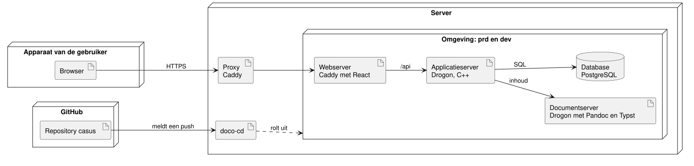

# ICDE: Integrated Course Design Environment

Onderwijs ontwerpen gebeurt nu in losse Word- en Excel-bestanden, die uit de pas lopen.
ICDE bewaart leeruitkomsten, rubrics, toetsen en lessen als data, controleert ze op consistentie
en genereert er documenten uit.

Dit is de casus van ons team voor de HAN-module OOSE Deeltijd 2026/2027.

## Architectuur

ICDE bestaat uit vier containers, die op één server in twee omgevingen draaien.



| Onderdeel                 | Map               | Techniek                   |
| ------------------------- | ----------------- | -------------------------- |
| Webserver met de frontend | `web/`            | Caddy, React, TypeScript   |
| Applicatieserver          | `api/`            | C++, Drogon                |
| Documentserver            | `documentserver/` | C++, Drogon, Pandoc, Typst |
| Database                  | `db/`             | PostgreSQL                 |

De applicatieserver bestaat uit lagen.
[docs/layers.md](docs/layers.md) legt uit welke laag welke laag mag gebruiken, en hoe de build
dat controleert.

## Hosting

ICDE draait op <https://icde.nl>.
Een merge naar een van deze branches komt vanzelf op de server.

| Omgeving           | Adres                                        | Branch    |
| ------------------ | -------------------------------------------- | --------- |
| Productie (prd)    | <https://icde.nl>, ook <https://prd.icde.nl> | `main`    |
| Ontwikkeling (dev) | <https://dev.icde.nl>                        | `develop` |

Naast ICDE zelf gebruikt de hosting deze programma's:

| Programma      | Functie                                                                      |
| -------------- | ---------------------------------------------------------------------------- |
| Caddy          | Proxy: regelt HTTPS en stuurt elke naam naar de juiste container             |
| GitHub Actions | Bouwt de images, draait de unittests en controleert lint en opmaak           |
| doco-cd        | Rolt een nieuwe versie uit na een merge                                      |
| Beszel         | Monitoring van de server en de containers, op <https://monitor.icde.nl>      |
| Pocket ID      | Accounts en inloggen met een passkey, voor Beszel, op <https://auth.icde.nl> |
| Dependabot     | Opent elke week een pull request met nieuwe versies                          |

## Start development

Installeer Docker Desktop, draai dit commando en open <http://localhost:8080>:

```sh
docker compose up -d --build
```

De eerste keer duurt het bouwen enkele minuten.
Draai hetzelfde commando opnieuw na een wijziging in de code.

## Lint en opmaak

Elke pull request draait de workflow Lint: clang-format en clang-tidy voor C++,
ESLint en Prettier voor TypeScript.
Een melding laat de workflow falen.
VS Code met de aanbevolen extensies formatteert een bestand bij het opslaan.

Controleer de frontend zelf, of herstel de opmaak met `npm run format`:

```sh
cd web && npm run lint
```

Controleer een C++-programma zelf, in `api/` of `documentserver/`:

```sh
cmake --preset lint && cmake --build --preset lint
```

## Documentatie

| Document                               | Inhoud                                      |
| -------------------------------------- | ------------------------------------------- |
| [Ontwerpdocument](docs/design/)        | Requirements en ontwerp, ook als [PDF][pdf] |
| [Techstack](docs/techstack.md)         | De gekozen tools, met de reden              |
| [Deployment](docs/deployment.md)       | Hoe een wijziging op de server komt         |
| [Werkafspraken](docs/werkafspraken.md) | Commits, branches, issues en pull requests  |
| [Server](docs/server.md)               | De server en wat erop is ingesteld          |

[pdf]: https://github.com/HAN-Craftsmanship-KL-JJG/casus/releases/tag/preview
