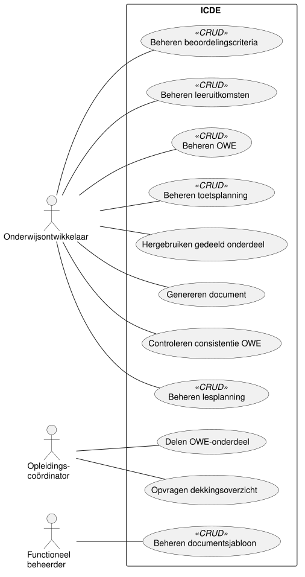
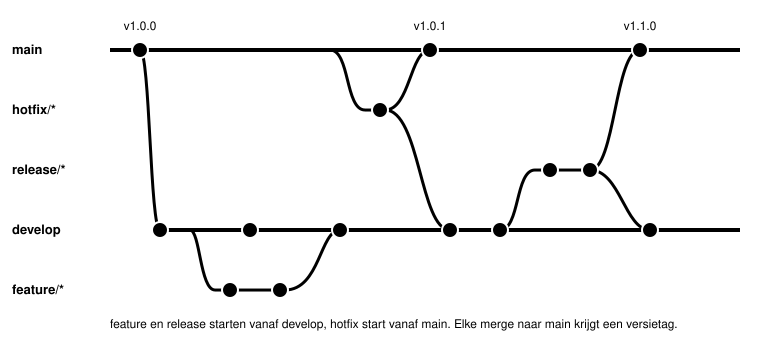

# ICDE: Integrated Course Design Environment

[](https://github.com/HAN-Craftsmanship-KL-JJG/casus/actions/workflows/ontwerpdocument.yml)
[](https://github.com/HAN-Craftsmanship-KL-JJG/casus/releases/tag/preview)

Onderwijs ontwerpen gebeurt nu in losse Word- en Excel-bestanden.
Leeruitkomsten, rubrics, toetsplanning en lesplanning lopen daardoor uit de pas, en niemand ziet
het op tijd.
ICDE bewaart die gegevens als data, controleert ze op consistentie en genereert er documenten
uit.

Dit is de casus van ons team voor de HAN-module OOSE Deeltijd 2026/2027.
De oorspronkelijke opdracht staat in [OPDRACHT.md](OPDRACHT.md).

## Wat ICDE doet

- Bewaart de gegevens van een onderwijseenheid (OWE) los van de vorm.
- Controleert of elke les bijdraagt aan een toets, en of elk beoordelingscriterium onderwijs
  heeft.
- Waarschuwt bij te veel toetsen in één week.
- Genereert de OWE-beschrijving, de toetsplanning en het beoordelingsformulier als PDF of Word.
- Laat meerdere ontwikkelaars tegelijk aan dezelfde OWE werken.
- Maakt onderdelen deelbaar tussen OWE's.



## Ontwerpdocument

Lees de laatste versie als PDF bij de
[preview-release](https://github.com/HAN-Craftsmanship-KL-JJG/casus/releases/tag/preview).
Elke merge naar `main` bouwt die PDF opnieuw uit de hoofdstukken in `docs/`.

| Hoofdstuk | Inhoud |
| --- | --- |
| [Inleiding](docs/01-inleiding.md) | Doel en opbouw |
| [Systeemgrenzen](docs/02-systeemgrenzen.md) | Actoren, scope en wensen van de opdrachtgever |
| [Use cases](docs/03-use-cases.md) | Use case diagram |
| [Use case beschrijvingen](docs/04-use-case-beschrijvingen.md) | Uitwerking, bedrijfsregels |
| [Domeinmodel](docs/05-domeinmodel.md) | Concepten en hun samenhang |
| [Architectuur](docs/06-architectuur.md) | Lagen, componenten en servers |
| [Klassendiagram](docs/07-klassendiagram.md) | Statisch ontwerp |
| [Sequence diagrams](docs/08-sequencediagrammen.md) | Dynamisch ontwerp |
| [Verantwoording](docs/09-verantwoording.md) | Eisen en consistentie |

## Planning

| Blok | Onderdeel | Resultaat | Status |
| --- | --- | --- | --- |
| 1 | SAD: Software Analysis & Design | Requirements en ontwerp in `docs/` | Bijna klaar |
| 2 | DAD: Distributed Application Development | Prototype op basis van het ontwerp | Volgt |

## Repository

```text
.
├── AGENTS.md        Afspraken voor AI-assistenten
├── OPDRACHT.md      Oorspronkelijke casusopdracht
├── docs/            Hoofdstukken van het ontwerpdocument
│   └── diagrams/    PlantUML-bronnen en gerenderde SVG's
└── .github/         Workflow die de PDF bouwt
```

Diagrammen staan in PlantUML.
Commit na elke wijziging aan een `.puml`-bestand ook de gerenderde SVG, want GitHub rendert geen
PlantUML.

## Werkafspraken

### Commitberichten

We schrijven commitberichten volgens [Conventional Commits](https://www.conventionalcommits.org/).
Het formaat is `type(scope): onderwerp`, bijvoorbeeld `docs(domeinmodel): voeg Toetsmoment toe`.
Toegestane types: `feat`, `fix`, `docs`, `refactor`, `test`, `perf`, `build`, `ci`, `chore`,
`style`, `revert`.
Koppel een issue in de footer met `Fixes #123` of `Refs #123`.

### Branches

We werken volgens [git flow](https://nvie.com/posts/a-successful-git-branching-model/).



- `main` bevat alleen opgeleverde versies.
  Elke merge naar `main` krijgt een versietag.
- `develop` verzamelt het werk voor de volgende oplevering.
- `feature/<onderwerp>` start vanaf `develop` en gaat via een pull request terug naar `develop`.
- `release/<versie>` start vanaf `develop` voor een oplevering.
  Na de laatste correcties gaat de branch naar `main` en terug naar `develop`.
- `hotfix/<onderwerp>` start vanaf `main` voor een dringende correctie.
  De branch gaat naar `main` en naar `develop`.

### Issues en pull requests

- Elk issue krijgt een label: `documentation`, `enhancement` of `question`.
- Een pull request noemt het issue in de beschrijving met `Fixes #123`.
- Titels van issues en pull requests zijn in het Nederlands, commitberichten in het Engels.
