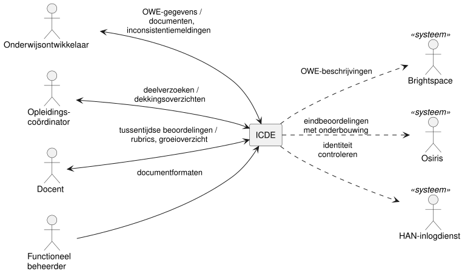

# Systeemgrenzen

Dit hoofdstuk bepaalt wat ICDE wel en niet doet, wie het gebruikt en wat in het prototype komt.

## Wat ICDE doet

ICDE ondersteunt het administratieve deel van het ontwikkelen van onderwijs.
Het prototype doet het volgende:

- Het bewaart de gegevens van een onderwijseenheid (OWE) als data, los van de vorm.
  Dit zijn leeruitkomsten, beoordelingscriteria (rubrics), de toetsplanning en de lesplanning.
  Er is nog geen standaardformaat: de gegevens staan nu in het OER en in ISAS.
- Het controleert de gegevens van een OWE op consistentie.
  Dit heeft de hoogste prioriteit.
  Voorbeelden: een beoordelingscriterium zonder les, of een les die niet bijdraagt aan een toets.
  ICDE controleert of de lessen 100% aansluiten bij de toetsen.
- Het waarschuwt als er meer dan 3 toetsen of opdrachten tegelijk in één week lopen.
- Het genereert documenten uit de gegevens, zoals de OWE-beschrijving, de EVL-beschrijving, de
  toetsplanning (als tabel en per week) en het beoordelingsformulier.
  De gebruiker kiest alle gegevens of een selectie, en PDF of Word.
  Een sjabloon bepaalt de vorm, en is aan te passen zonder de inhoud te wijzigen.
- Het laat meerdere ontwikkelaars tegelijk aan dezelfde OWE werken.
  Invoer gaat real-time naar de backend.
  Een invoerveld is geblokkeerd zolang iemand het wijzigt, de rest van de OWE blijft bewerkbaar.
- Het maakt onderdelen van een OWE deelbaar met andere OWE's binnen HBO-ICT.
- Het regelt het inloggen zelf.
  Alle gebruikers zien dezelfde gegevens.

Later, buiten het prototype:

- Een koppeling met SURFconext voor het inloggen.
- Een koppeling met Brightspace en Osiris.

Buiten ICDE:

- De leeromgeving: studenten volgen hun onderwijs in Brightspace.
- De cijferadministratie: eindbeoordelingen staan in Osiris.
- Beoordelen: ICDE legt geen beoordelingen vast, dus ook geen gegevens voor Iterative Grading.
- De inhoud van onderwijs: ICDE signaleert inconsistenties, en de ontwikkelaar beslist wat er
  verandert.

### Begrippen

- Een OWE (onderwijseenheid) is een module, zoals OOSE-DT.
- Een OWE bestaat uit een of meer eenheden van leeruitkomsten (EVL's).
  OOSE-DT heeft bijvoorbeeld de EVL's Software Analysis & Design en Distributed Application
  Development.
- Een EVL groepeert leeruitkomsten en de toetsen die ze beoordelen.
- Een toetsmoment is een toets of opdracht in de toetsplanning.
  Het loopt van een startweek tot en met een deadlineweek, en beoordeelt beoordelingscriteria.

## Contextdiagram

Primary actors staan links, supporting actors rechts.
Een stippellijn is een koppeling voor later, buiten het prototype.
Bij een label met een schuine streep staat eerst wat de actor levert, daarna wat ICDE teruggeeft.

## Actoren

### Primary actors

Een primary actor gebruikt ICDE om een eigen doel te halen.
Onderwijsontwikkelaar en opleidingscoördinator zijn aparte rollen.

- Onderwijsontwikkelaar
  - Doel: een OWE consistent ontwerpen en vastleggen.
  - Legt leeruitkomsten, beoordelingscriteria, de toetsplanning en lessen vast.
  - Ontvangt gegenereerde documenten en meldingen over inconsistenties.
- Opleidingscoördinator
  - Doel: bewaken dat de opleiding alle leeruitkomsten dekt, en onderdelen hergebruiken.
  - Vraagt overzichten op van de dekking van leeruitkomsten.
  - Deelt OWE-onderdelen met andere OWE's binnen HBO-ICT.
- Functioneel beheerder
  - Doel: documentformaten aanpassen aan de wensen van een opleiding.
  - Beheert sjablonen voor OWE-beschrijvingen en beoordelingsformulieren.

### Supporting actors

Een supporting actor levert een dienst aan ICDE of ontvangt gegevens van ICDE.
Het prototype heeft met geen van hen een koppeling.

- Brightspace: ontvangt later gegenereerde OWE-beschrijvingen en publiceert ze.
- Osiris: de cijferadministratie, waarmee ICDE later koppelt.
- HAN-inlogdienst (SURFconext): controleert later de identiteit van gebruikers.

### Offstage stakeholders

Een offstage stakeholder gebruikt ICDE niet zelf, maar heeft wel belang bij het resultaat.

- Docent: beoordeelt studenten met het beoordelingsformulier dat ICDE genereert, maar legt de
  beoordelingen elders vast.
- Student: wil transparant zien hoe de eigen beoordeling tot stand komt.
