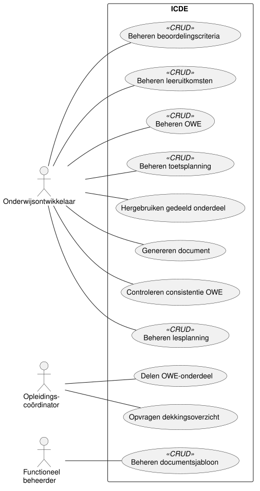

# Use cases

De actoren en de scope uit het vorige hoofdstuk leiden tot de use cases van ICDE.
Dit hoofdstuk toont het use case diagram en licht de keuzes toe.
Het volgende hoofdstuk werkt de belangrijkste use cases uit.

## Use case diagram

## Overzicht use cases

We vonden de use cases per primary actor, vanuit de doelen van die actor.
Elke use case is een elementair bedrijfsproces: één persoon voert het uit op één plaats en één
moment, en de gegevens zijn daarna consistent.

| ID | Use case | Primary actor | CRUD | Prioriteit |
| --- | --- | --- | --- | --- |
| UC01 | Beheren OWE | Onderwijsontwikkelaar | ja | hoog |
| UC02 | Beheren leeruitkomsten | Onderwijsontwikkelaar | ja | hoog |
| UC03 | Beheren beoordelingscriteria | Onderwijsontwikkelaar | ja | hoog |
| UC04 | Beheren lesplanning | Onderwijsontwikkelaar | ja | hoog |
| UC05 | Controleren consistentie OWE | Onderwijsontwikkelaar | nee | hoog |
| UC06 | Genereren document | Onderwijsontwikkelaar | nee | hoog |
| UC07 | Hergebruiken gedeeld onderdeel | Onderwijsontwikkelaar | nee | middel |
| UC08 | Opvragen dekkingsoverzicht | Opleidingscoördinator | nee | hoog |
| UC09 | Delen OWE-onderdeel | Opleidingscoördinator | nee | middel |
| UC10 | Beheren documentsjabloon | Functioneel beheerder | ja | middel |
| UC11 | Beheren toetsplanning | Onderwijsontwikkelaar | ja | hoog |

Het doel van elke use case:

- UC01 Beheren OWE: een onderwijseenheid aanmaken, bekijken, wijzigen en verwijderen.
- UC02 Beheren leeruitkomsten: de leeruitkomsten van een OWE vastleggen, per EVL.
- UC03 Beheren beoordelingscriteria: beoordelingsdimensies, criteria en niveaus (de rubric) van
  een OWE vastleggen.
- UC04 Beheren lesplanning: lessen vastleggen en per les aangeven aan welke beoordelingscriteria
  die bijdraagt.
- UC05 Controleren consistentie OWE: het systeem meldt inconsistenties.
  Voorbeelden: een beoordelingscriterium zonder les, of een les die niet bijdraagt aan een
  beoordelingscriterium.
- UC06 Genereren document: het systeem maakt uit de gegevens van een OWE een document met een
  gekozen sjabloon.
  De gebruiker kiest alle gegevens of een selectie, en kiest PDF of Word.
  Soorten documenten zijn de OWE-beschrijving, de EVL-beschrijving, de toetsplanning en het
  beoordelingsformulier.
- UC07 Hergebruiken gedeeld onderdeel: een ontwikkelaar neemt een gedeeld onderdeel op in de eigen
  OWE.
- UC08 Opvragen dekkingsoverzicht: het systeem toont per leeruitkomst van een opleiding hoeveel
  criteria, toetsmomenten en lessen eraan bijdragen.
- UC09 Delen OWE-onderdeel: een onderdeel van een OWE beschikbaar maken voor andere OWE's
  binnen HBO-ICT.
  Delen met andere opleidingen is niet nodig.
- UC10 Beheren documentsjabloon: sjablonen voor documenten vastleggen, los van de inhoud.
  Een sjabloon bepaalt welke onderdelen een document toont, in welke volgorde en met welke opmaak.
  [Systeemgrenzen](02-systeemgrenzen.md#systeemgrenzen) noemt dit documentformaten.
  Het bestandstype (PDF of Word) kiest de gebruiker in UC06.
- UC11 Beheren toetsplanning: toetsmomenten vastleggen, met een startweek, een deadlineweek en de
  beoordelingscriteria die ze beoordelen.
  Het systeem waarschuwt als er meer dan 3 toetsen in een week lopen.

## Eis: maximaal 65% CRUD

De casus eist minimaal 10 use cases, waarvan maximaal 65% CRUD.
Het diagram heeft 11 use cases.
Daarvan zijn er 6 CRUD: UC01, UC02, UC03, UC04, UC10 en UC11.
Dat is 55%.

## Keuzes

### Stereotype «CRUD»

Voor het beheren van een item tekenen we één use case met «CRUD», zoals de cursus voorschrijft
(CRUD Use Cases).
Het stereotype is een verkorte weergave van toevoegen, bekijken, wijzigen en verwijderen.
Het blijft één use case, ook bij de telling van 65% CRUD.
De vier acties volgen het CRUD-sjabloon van de cursus.
Zie [CRUD use cases](04-use-case-beschrijvingen.md#crud-use-cases).

### Geen «include» of «extend»

Die geven in dit diagram geen meerwaarde.

### Geen use case Inloggen

Inloggen levert zelf geen waarde voor de gebruiker, en is dus geen elementair bedrijfsproces.
Een ingelogde gebruiker is een preconditie van elke use case.
ICDE regelt het inloggen voorlopig zelf.
Een koppeling met de HAN-inlogdienst (SURFconext) kan later, en staat niet in het diagram.

### Geen use case voor samenwerken zonder versieconflicten

Dit is een eigenschap van alle wijzig-use cases, geen apart doel van een actor.
We leggen het vast als niet-functionele requirement.
De opdrachtgever bedoelt: een invoerveld is geblokkeerd zolang iemand het wijzigt, en de rest
van de OWE blijft bewerkbaar.

### Prioriteit

Hoog zijn de use cases die de kern van de casus vormen: gegevens vastleggen, controleren en
documenten genereren.
Middel zijn delen, hergebruiken en het beheer van sjablonen.
UC05 Controleren consistentie OWE heeft de hoogste prioriteit, omdat de opdrachtgever
gegevensvalidatie van een OWE voorop zet.

## Buiten het diagram

Deze kandidaat-use cases vallen buiten het prototype.
Ze staan niet in het diagram.

- Vastleggen tussentijdse beoordeling en Bekijken groeioverzicht, voor Iterative Grading.
  Actor: docent.
  ICDE legt geen beoordelingen vast.
- Publiceren OWE-beschrijving in Brightspace.
- Doorzetten eindbeoordeling naar Osiris.
  Het prototype heeft geen koppeling met Brightspace of Osiris.

Daarom staan de docent, Brightspace en Osiris uit
[Actoren](02-systeemgrenzen.md#actoren) niet in het diagram.
De student is geen gebruiker van ICDE, en heeft dus geen use case.
