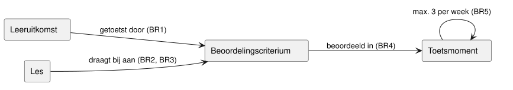

# Use case beschrijvingen

Dit hoofdstuk werkt de belangrijkste use cases uit het
[use case diagram](03-use-cases.md#use-case-diagram) uit.
Het legt ook de bedrijfsregels BR1 tot en met BR14 vast, waar de rest van het document naar
verwijst.

## Aanpak

We volgen het fully dressed Use Case template van de cursus, met de sectienamen in het Engels.
Het main success scenario heeft twee kolommen, met doorlopende stapnummers.
Een extensie heet naar de stap waar ze begint (3A), met de conditie tussen rechte haken.
Zonder "Ga naar stap N" of "Einde use case" gaat het main success scenario verder.

De cursus legt de nadruk op use cases met logica, niet op CRUD.
Daarom werken we UC05, UC06, UC07 en UC08 fully dressed uit.
Van de CRUD use cases werken we alleen het toevoegen uit bij UC04 en UC11.
Daar koppelt het systeem de planning aan de beoordelingscriteria en controleert het een regel.

## Bedrijfsregels

De consistentieregels controleren de verbanden tussen de onderdelen van een OWE:

Consistentieregels:

- BR1: Elke leeruitkomst van een OWE wordt getoetst door minstens één beoordelingscriterium.
- BR2: Elke les draagt bij aan minstens één beoordelingscriterium.
- BR3: Elk beoordelingscriterium heeft minstens één les die eraan bijdraagt.
- BR4: Elk beoordelingscriterium wordt beoordeeld in minstens één toetsmoment.
- BR5: In geen enkele onderwijsweek lopen meer dan 3 toetsmomenten van de OWE tegelijk.
  Een toetsmoment loopt van zijn startweek tot en met zijn deadlineweek.

BR3 en BR4 samen controleren of lessen en toetsen 100% op elkaar aansluiten, zoals de
opdrachtgever vraagt.

Regels voor gedeelde onderdelen:

- BR6: Een OWE die een gedeeld onderdeel hergebruikt, toont altijd de actuele versie ervan.
- BR7: Alleen ontwikkelaars van de OWE van herkomst kunnen een gedeeld onderdeel wijzigen.

Validatieregels:

- BR8: Een OWE heeft een unieke code, een naam en een looptijd van minstens één onderwijsweek.
  Ze hoort bij één opleiding en heeft minstens één EVL, elk met een naam en studiepunten.
- BR9: Een leeruitkomst heeft een omschrijving en een nummer dat uniek is binnen de OWE.
  Ze hoort bij één EVL van de OWE.
- BR10: Een beoordelingscriterium hoort bij één beoordelingsdimensie van dezelfde OWE.
- BR11: Een les heeft een naam en een onderwijsweek binnen de looptijd van de OWE.
  Ze draagt alleen bij aan beoordelingscriteria van dezelfde OWE, eigen of hergebruikt.
- BR12: Een documentsjabloon heeft een unieke naam en is voor één soort document.
- BR13: Een onderdeel dat een andere OWE hergebruikt, kan niet worden verwijderd.
- BR14: Een toetsmoment heeft een naam, en een startweek en deadlineweek binnen de looptijd van
  de OWE.
  De startweek ligt niet na de deadlineweek.
  Het beoordeelt alleen beoordelingscriteria van dezelfde OWE, eigen of hergebruikt.

## UC05 Controleren consistentie OWE

- Primary actor: Onderwijsontwikkelaar.
- Stakeholders and interests:
  - Onderwijsontwikkelaar: wil fouten in het ontwerp vroeg zien, zonder handmatig te tellen.
  - Student: wil op elk beoordelingscriterium worden voorbereid in de lessen.
- Cross references: BR1 tot en met BR5.
- Brief description: Het systeem controleert een OWE op de consistentieregels en toont elke
  overtreding.
- Preconditions: De OWE bestaat.
- Postconditions on success: Het systeem heeft elke overtreding van BR1 tot en met BR5 getoond.
  De gegevens van de OWE zijn niet gewijzigd.
- Postconditions on failure: De gegevens van de OWE zijn niet gewijzigd.

Main success scenario:

| Actor action | System responsibility |
| --- | --- |
| 1. De ontwikkelaar kiest een OWE en vraagt een consistentiecontrole aan. | |
| | 2. Het systeem past BR1 tot en met BR5 toe op de gegevens van de OWE. |
| | 3. Het systeem toont per regel de onderdelen die de regel overtreden. |

Alternate flows:

- 3A. [De OWE overtreedt geen enkele regel]
  - 3A1. Het systeem meldt dat de OWE consistent is.

Exceptional flows:

- 2A. [De OWE heeft geen leeruitkomsten]
  - 2A1. Het systeem meldt dat de OWE geen leeruitkomsten heeft.
  - 2A2. Einde use case.

## UC06 Genereren document

- Primary actor: Onderwijsontwikkelaar.
- Stakeholders and interests:
  - Onderwijsontwikkelaar: wil een document zonder de gegevens opnieuw te typen.
  - Functioneel beheerder: wil het sjabloon wijzigen zonder de inhoud aan te raken.
- Cross references: BR12, UC10 levert de sjablonen.
- Brief description: Het systeem maakt uit de gekozen gegevens van een OWE een PDF- of
  Word-document met een sjabloon.
  Soorten documenten zijn de OWE-beschrijving, de EVL-beschrijving, de toetsplanning en het
  beoordelingsformulier.
- Preconditions: De OWE bestaat.
  Er is minstens één documentsjabloon.
- Postconditions on success: Er is een PDF- of Word-document dat de gekozen onderdelen van de OWE
  toont volgens het gekozen sjabloon.
- Postconditions on failure: Er is geen document gemaakt.

Main success scenario:

| Actor action | System responsibility |
| --- | --- |
| 1. De ontwikkelaar kiest een OWE en geeft aan een document te willen maken. | |
| | 2. Het systeem toont de documentsjablonen, per soort document. |
| 3. De ontwikkelaar kiest een sjabloon, de onderdelen (alle of een selectie) en PDF of Word. | |
| | 4. Het systeem controleert of de OWE de gegevens van de gekozen onderdelen heeft. |
| | 5. Het systeem maakt het document en levert het aan de ontwikkelaar. |

Alternate flows:

- 3A. [De ontwikkelaar kiest geen onderdelen]
  - 3A1. Het systeem neemt alle onderdelen van het sjabloon.

Exceptional flows:

- 4A. [De OWE mist gegevens van de gekozen onderdelen]
  - 4A1. Het systeem toont welke gegevens ontbreken.
  - 4A2. Einde use case.

## UC07 Hergebruiken gedeeld onderdeel

- Primary actor: Onderwijsontwikkelaar.
- Stakeholders and interests:
  - Onderwijsontwikkelaar: wil een bestaand onderdeel gebruiken in plaats van het opnieuw te
    schrijven.
  - Opleidingscoördinator: wil dat verbeteringen aan een gedeeld onderdeel aankomen bij
    elke OWE die het hergebruikt.
- Cross references: BR6, BR7, BR13, UC09 maakt een onderdeel gedeeld.
- Brief description: De ontwikkelaar neemt een gedeeld onderdeel op in de eigen OWE, als
  verwijzing of als kopie.
  Een kopie kan alleen van een les of toetsmoment.
  Een leeruitkomst of rubric blijft een verwijzing, zodat elke OWE dezelfde versie gebruikt.
- Preconditions: Er is minstens één gedeeld onderdeel dat de OWE nog niet bevat.
- Postconditions on success: De OWE bevat het gekozen onderdeel, als verwijzing of als kopie.
- Postconditions on failure: De OWE is niet gewijzigd.

Main success scenario:

| Actor action | System responsibility |
| --- | --- |
| 1. De ontwikkelaar kiest een OWE en geeft aan een gedeeld onderdeel te willen opnemen. | |
| | 2. Het systeem toont de gedeelde onderdelen die de OWE nog niet bevat. |
| 3. De ontwikkelaar kiest een onderdeel en bevestigt. | |
| | 4. Het systeem neemt een verwijzing naar het onderdeel op in de OWE [BR6]. |

Alternate flows:

- 3A. [De ontwikkelaar wil een les of toetsmoment aanpassen aan de eigen OWE]
  - 3A1. De ontwikkelaar kiest voor een kopie.
  - 3A2. Het systeem neemt een kopie op, die niet meer afhangt van het origineel.
    De kopie heeft geen koppelingen met criteria, want die horen bij de andere OWE [BR11, BR14].
  - 3A3. Einde use case.

Exceptional flows:

- 3A2A. [De week van de kopie ligt buiten de looptijd van de eigen OWE]
  - 3A2A1. Het systeem meldt welke week ongeldig is en neemt geen kopie op [BR11, BR14].
  - 3A2A2. Ga naar stap 2.
- 4A. [Het origineel is verwijderd sinds stap 2]
  - 4A1. Het systeem meldt dat het onderdeel niet meer bestaat.
  - 4A2. Ga naar stap 2.

## UC08 Opvragen dekkingsoverzicht

- Primary actor: Opleidingscoördinator.
- Stakeholders and interests:
  - Opleidingscoördinator: wil zien of de opleiding elke leeruitkomst voldoende afdekt.
  - Onderwijsontwikkelaar: wil weten welke leeruitkomsten meer onderwijs nodig hebben.
- Cross references: BR1, BR3, BR4.
- Brief description: Het systeem toont per leeruitkomst van een opleiding hoeveel criteria,
  toetsmomenten en lessen eraan bijdragen, en markeert de gaten.
- Preconditions: De opleiding heeft minstens één OWE.
- Postconditions on success: Het systeem heeft per leeruitkomst het aantal criteria,
  toetsmomenten en lessen getoond.
  Elke leeruitkomst waarvan een van die aantallen 0 is, is gemarkeerd.
- Postconditions on failure: Het systeem heeft geen overzicht getoond.

Main success scenario:

| Actor action | System responsibility |
| --- | --- |
| 1. De coördinator kiest een opleiding en vraagt het dekkingsoverzicht op. | |
| | 2. Het systeem verzamelt de leeruitkomsten van alle OWE's van de opleiding. |
| | 3. Het systeem telt per leeruitkomst de criteria, toetsmomenten en lessen. |
| | 4. Het systeem toont de aantallen en markeert elke leeruitkomst met een aantal 0. |

Alternate flows:

- 4A. [Geen enkel aantal is 0]
  - 4A1. Het systeem meldt dat de opleiding alle leeruitkomsten afdekt.

Exceptional flows:

- 2A. [Geen OWE van de opleiding heeft leeruitkomsten]
  - 2A1. Het systeem meldt dat er geen leeruitkomsten zijn om te tonen.
  - 2A2. Einde use case.

## CRUD use cases

Elke «CRUD» use case bestaat uit toevoegen, bekijken, wijzigen en verwijderen, volgens het
CRUD-sjabloon van de cursus.
De stap "Systeem controleert of gegevens valide zijn" gebruikt deze regels:

| Use case | Item | Validatieregels |
| --- | --- | --- |
| UC01 Beheren OWE | OWE met EVL's | BR8, BR13 bij verwijderen |
| UC02 Beheren leeruitkomsten | Leeruitkomst | BR9, BR13 bij verwijderen |
| UC03 Beheren beoordelingscriteria | Beoordelingscriterium | BR10, BR13 bij verwijderen |
| UC04 Beheren lesplanning | Les | BR11, daarna controle BR2, BR13 bij verwijderen |
| UC10 Beheren documentsjabloon | Documentsjabloon | BR12 |
| UC11 Beheren toetsplanning | Toetsmoment | BR14, daarna controle BR5, BR13 bij verwijderen |

Bij UC04 en UC11 controleert het systeem na het opslaan een consistentieregel.
Daarom werken we het toevoegen hieronder uit.
Wijzigen doet dezelfde controle.

Niet-functionele eis voor alle wijzig-acties: meerdere ontwikkelaars wijzigen tegelijk dezelfde
OWE.
Een invoerveld is geblokkeerd voor anderen zolang een ontwikkelaar het wijzigt.
De rest van de OWE blijft bewerkbaar.

### UC04 Toevoegen les

- Primary actor: Onderwijsontwikkelaar.
- Cross references: BR2, BR11, UC03 levert de beoordelingscriteria.
- Preconditions: De OWE bestaat.
- Postconditions on success: De OWE heeft een nieuwe les die voldoet aan BR11.
- Postconditions on failure: De lesplanning van de OWE is niet gewijzigd.

Main success scenario:

| Actor action | System responsibility |
| --- | --- |
| 1. De ontwikkelaar geeft aan een les te willen toevoegen aan een OWE. | |
| | 2. Het systeem toont de invoervelden en de criteria van de OWE. |
| 3. De ontwikkelaar vult naam, onderwijsweek en beschrijving in, kiest criteria en bevestigt. | |
| | 4. Het systeem controleert of de gegevens valide zijn [BR11]. |
| | 5. Het systeem slaat de les op. |
| | 6. Het systeem controleert of de les bijdraagt aan een criterium [BR2]. |

Alternate flows:

- 6A. [De les draagt aan geen enkel criterium bij]
  - 6A1. Het systeem waarschuwt dat de les BR2 overtreedt.

Exceptional flows:

- 4A. [De gegevens zijn niet valide]
  - 4A1. Het systeem meldt welke gegevens onjuist zijn.
  - 4A2. Ga naar stap 2.

### UC11 Toevoegen toetsmoment

- Primary actor: Onderwijsontwikkelaar.
- Cross references: BR5, BR14, UC03 levert de beoordelingscriteria.
- Preconditions: De OWE bestaat.
- Postconditions on success: De OWE heeft een nieuw toetsmoment dat voldoet aan BR14.
  Overtreedt de toetsplanning BR5, dan heeft het systeem gewaarschuwd.
- Postconditions on failure: De toetsplanning van de OWE is niet gewijzigd.

Main success scenario:

| Actor action | System responsibility |
| --- | --- |
| 1. De ontwikkelaar geeft aan een toetsmoment te willen toevoegen aan een OWE. | |
| | 2. Het systeem toont de invoervelden en de criteria van de OWE. |
| 3. De ontwikkelaar vult naam, soort, start- en deadlineweek in, kiest criteria en bevestigt. | |
| | 4. Het systeem controleert of de gegevens valide zijn [BR14]. |
| | 5. Het systeem slaat het toetsmoment op. |
| | 6. Het systeem telt per week van het toetsmoment de lopende toetsmomenten [BR5]. |

Alternate flows:

- 6A. [In een week lopen meer dan 3 toetsmomenten]
  - 6A1. Het systeem waarschuwt en toont die weken met hun toetsmomenten.

Exceptional flows:

- 4A. [De gegevens zijn niet valide]
  - 4A1. Het systeem meldt welke gegevens onjuist zijn.
  - 4A2. Ga naar stap 2.

## UC09 Delen OWE-onderdeel (brief format)

De opleidingscoördinator kiest een onderdeel van een OWE, zoals een leeruitkomst of een rubric.
Het systeem maakt het onderdeel zichtbaar voor de andere OWE's binnen HBO-ICT.
Een ontwikkelaar kan het daarna hergebruiken met UC07.
