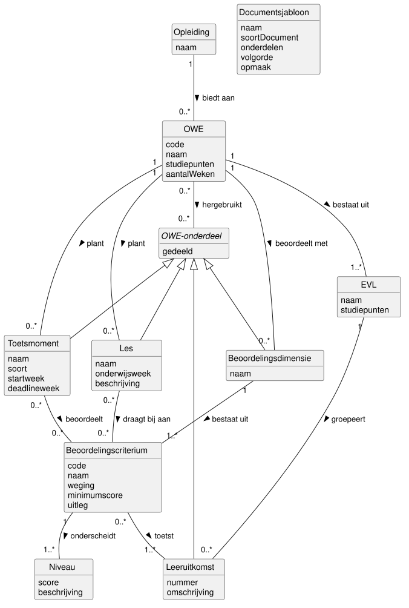

# Domeinmodel

De use cases en bedrijfsregels noemen de begrippen waar ICDE mee werkt.
Dit hoofdstuk legt die begrippen en hun verbanden vast in een domeinmodel, en controleert het model
tegen de use cases.

## Aanpak

We volgen de regels voor een domeinmodel uit de cursus.
We vonden de concepten met Noun Phrase Identification (NPI) volgens het stappenplan van de
cursus.

## Diagram

## Kandidaat-concepten

We onderstreepten de zelfstandige naamwoorden in de casus, de Modulebeschrijving en de
use case beschrijvingen.
Daarna schiftten we ze: dubbele namen, synoniemen, rollen en dingen buiten het systeem vielen af.

| Zelfstandig naamwoord | Besluit | Reden |
| --- | --- | --- |
| opleiding | concept | UC08 kiest een opleiding. |
| profiel, opleidingsprofiel | geen concept | De HAN kent geen profielen, zie D3. |
| OWE, onderwijseenheid, module | concept OWE | Drie namen voor hetzelfde. |
| eenheid van leeruitkomsten | concept EVL | ICDE genereert de EVL-beschrijving. |
| leeruitkomst, leerdoel | concept Leeruitkomst | De casus gebruikt beide woorden. |
| beoordelingsdimensie | concept | Groep criteria in de rubric. |
| beoordelingscriterium | concept | De kern van de consistentiecontrole. |
| niveau | concept | Een criterium heeft niveaus met elk een beschrijving. |
| les, lesplanning | concept Les | De lesplanning is de verzameling lessen. |
| toets, opdracht, toetsmoment | concept Toetsmoment | Toets en opdracht zijn soorten. |
| onderdeel, onderwijsonderdeel | concept OWE-onderdeel | Wat een OWE deelt, zie D2. |
| documentsjabloon, documentformaat, sjabloon | concept Documentsjabloon | Vorm los van inhoud. |
| rubric | geen concept | Een dimensie met criteria en niveaus. |
| toetsplanning | geen concept | De verzameling toetsmomenten. |
| onderwijsweek | attribuut | Een weeknummer zonder eigen eigenschappen. |
| ontwikkelaar, coördinator, beheerder | geen concept | Rollen van actoren, geen domeinkennis. |
| OWE-beschrijving, beoordelingsformulier | geen concept | Uitvoer van UC06, niet bewaard. |
| PDF, Word | geen concept | Bestandstype dat de gebruiker kiest in UC06. |
| student, beoordeling | geen concept | ICDE legt geen beoordelingen vast. |
| inconsistentie, dekkingsoverzicht | geen concept | Uitvoer van UC05 en UC08. |
| versie, versiebeheer | geen concept | Een niet-functionele eis voor samenwerken. |
| Brightspace, Osiris | geen concept | Externe systemen zonder koppeling in het prototype. |
| didactiek | geen concept | Een werkwijze, geen ding met gegevens. |

## Concepten

De casus eist minimaal 10 concepten.
Het model heeft er 11: alleen de concepten die een use case nodig heeft.

| Concept | Betekenis |
| --- | --- |
| Opleiding | Een HBO-opleiding, zoals HBO-ICT. |
| OWE | Een onderwijseenheid, zoals OOSE-DT. |
| EVL | Een eenheid van leeruitkomsten van een OWE. |
| OWE-onderdeel | Een deel van een OWE dat te delen is. |
| Leeruitkomst | Wat een student na de OWE kan. |
| Beoordelingsdimensie | Een groep criteria, de rubric. |
| Beoordelingscriterium | Een eis in de rubric. |
| Niveau | Een score op een criterium. |
| Les | Een les in de lesplanning. |
| Toetsmoment | Een toets of opdracht. |
| Documentsjabloon | De vorm van een soort document. |

OWE-onderdeel is abstract: elk onderdeel is een leeruitkomst, dimensie, les of toetsmoment.

Toelichting bij enkele attributen:

- aantalWeken van OWE is de looptijd in onderwijsweken, zie BR8.
- weging en minimumscore komen uit de rubric.
  In de rubric van OOSE-DT heeft criterium B_Casus1-2 weging 10 en minimum 4.
- soort van Toetsmoment is toets of opdracht.
- soortDocument is OWE-beschrijving, EVL-beschrijving, toetsplanning of beoordelingsformulier.
- gedeeld zegt of andere OWE's het onderdeel kunnen hergebruiken (UC09).
- onderdelen, volgorde en opmaak van Documentsjabloon bepalen welke gegevens het document toont,
  in welke volgorde en hoe.
  Het bestandstype (PDF of Word) is geen attribuut, want de gebruiker kiest het per document in
  UC06.

## Associaties

Een multipliciteit staat bij het concept waarvan je het aantal telt.
We stelden per associatie de vraag uit het werkboek: met hoeveel B's heeft een A te maken,
gedurende het hele bestaan van A?

| Associatie | Multipliciteit | Onderbouwing |
| --- | --- | --- |
| Opleiding biedt OWE aan | 1 : 0..* | Een OWE hoort bij één opleiding, de eigenaar. |
| OWE bestaat uit EVL | 1 : 1..* | De casus: een OWE bestaat uit een of meer EVL's. |
| EVL groepeert Leeruitkomst | 1 : 0..* | UC05 meldt een OWE zonder leeruitkomsten (2A). |
| OWE beoordeelt met Beoordelingsdimensie | 1 : 0..* | Een nieuwe OWE heeft nog geen rubric. |
| Beoordelingsdimensie bestaat uit Beoordelingscriterium | 1 : 1..* | BR10, groep criteria. |
| Beoordelingscriterium onderscheidt Niveau | 1 : 1..* | Zonder niveau valt er niets te scoren. |
| OWE plant Les | 1 : 0..* | Een nieuwe OWE heeft nog geen lessen. |
| OWE plant Toetsmoment | 1 : 0..* | Een nieuwe OWE heeft nog geen toetsen. |
| Beoordelingscriterium toetst Leeruitkomst | 0..* : 1..* | BR1 controleert de kant 0..*. |
| Les draagt bij aan Beoordelingscriterium | 0..* : 0..* | BR2 en BR3. |
| Toetsmoment beoordeelt Beoordelingscriterium | 0..* : 0..* | BR4. |
| OWE hergebruikt OWE-onderdeel | 0..* : 0..* | UC07, BR6, BR7, BR13. |

Voorbeeld van lezen: Beoordelingscriterium toetst Leeruitkomst, 0..* : 1..*.
Een criterium toetst minstens één leeruitkomst.
Een leeruitkomst wordt door nul of meer criteria getoetst.

Documentsjabloon heeft geen associatie.
Een sjabloon geldt voor alle OWE's.
UC06 combineert een sjabloon en een OWE pas bij het genereren.

## Beperkingen die het diagram niet toont

Een UML-multipliciteit kan niet alles zeggen.
Deze regels gelden ook.
De codes verwijzen naar de
[bedrijfsregels](04-use-case-beschrijvingen.md#bedrijfsregels).
Met "een onderdeel van de OWE" bedoelen we een eigen onderdeel, of een onderdeel dat de OWE
hergebruikt.

- Een criterium toetst alleen leeruitkomsten van de OWE van zijn dimensie.
- Een les en een toetsmoment koppelen alleen criteria van hun OWE (BR11, BR14).
- onderwijsweek, startweek en deadlineweek liggen binnen aantalWeken van de OWE (BR11, BR14).
- Een OWE hergebruikt alleen onderdelen van een andere OWE met gedeeld = ja.

## Keuzes

### D1 Minimum 0 bij de consistentieregels

Probleem: BR1 tot en met BR4 zeggen "minstens één".
Welke multipliciteit krijgen die associaties?

Alternatief: 1..*, zoals de regels zeggen.
Dan kan ICDE een OWE met een inconsistentie niet bewaren, en kan UC05 die niet melden.

Keuze: 0..*.
Een ontwikkelaar legt eerst een les vast en koppelt later de criteria.
UC04 waarschuwt dan, maar slaat de les wel op (flow 6A).

### D2 Generalisatie OWE-onderdeel

Probleem: UC09 deelt "een onderdeel, zoals een leeruitkomst of een rubric".
Leeruitkomst, Beoordelingsdimensie, Les en Toetsmoment zijn allemaal te delen.
Hoe toont het model dat?

Alternatief: een aparte associatie hergebruikt per soort onderdeel.
Dat zijn vier lijnen die hetzelfde zeggen.

Keuze: een abstract concept OWE-onderdeel met vier specialisaties.
De generalisatie laat zien dat delen (UC09) en hergebruiken (UC07) voor alle vier hetzelfde
werken.
Een gedeelde dimensie neemt haar criteria en niveaus mee.
Een kopie (UC07, flow 3A) is een nieuw onderdeel van de eigen OWE, geen hergebruik.

### D3 Geen concept Profiel

Probleem: de casus noemt delen "tussen opleidingen en profielen".

Alternatief: een concept Profiel, als specialisatie binnen een opleiding.
De HAN kent zulke profielen niet, en Opleiding dekt dit al.

Keuze: geen concept Profiel.
ICDE deelt alleen binnen HBO-ICT, dus een onderdeel is gedeeld of niet.
Het attribuut gedeeld legt dat vast, en een gedeeld onderdeel is zichtbaar voor elke andere OWE.

### D4 Geen compositie

Probleem: bijna elk concept bestaat niet zonder zijn OWE.

Alternatief: compositie bij elk van die associaties.
Dan staat compositie bijna overal, en dat voegt geen informatie toe.

Keuze: gewone associaties.
De cursus vraagt geen compositie in een domeinmodel.

### D5 Les en Toetsmoment hangen aan de OWE, niet aan een EVL

Probleem: [Begrippen](02-systeemgrenzen.md#begrippen) zegt dat een EVL leeruitkomsten groepeert
en de toetsen die ze beoordelen.
In de lesplanning van OOSE-DT staat ook per les een EVL.

Alternatief: een directe associatie van Les en Toetsmoment naar EVL.
Die EVL volgt al uit de criteria: criterium, leeruitkomst, EVL.
Een directe associatie is dus dubbel en kan tegenspreken.

Keuze: Les en Toetsmoment hangen aan de OWE.
Dit is de stap "controleer op redundantie" uit het stappenplan.

## Validatie

Deze sectie toont aan dat het domeinmodel de use cases dekt.
Dit is de stap "Valideer het model" uit het NPI-stappenplan van de cursus.

### Dekking per use case

| Use case | Regels | Gegevens | In het model |
| --- | --- | --- | --- |
| UC01 Beheren OWE | BR8, BR13 | OWE met opleiding en EVL's | OWE, biedt aan, bestaat uit |
| UC02 Beheren leeruitkomsten | BR9, BR13 | Leeruitkomst met EVL | Leeruitkomst, groepeert |
| UC03 Beheren beoordelingscriteria | BR10, BR13 | Rubric, getoetste leeruitkomsten | Beoordelingsdimensie, Beoordelingscriterium, Niveau, toetst |
| UC04 Beheren lesplanning | BR2, BR11, BR13 | Les met criteria | Les, plant, draagt bij aan |
| UC05 Controleren consistentie OWE | BR1 tot en met BR5 | Koppelingen en weken | toetst, draagt bij aan, beoordeelt, startweek, deadlineweek |
| UC06 Genereren document | BR12 | Sjabloon en inhoud van de OWE | Documentsjabloon, OWE met haar onderdelen |
| UC07 Hergebruiken gedeeld onderdeel | BR6, BR7, BR13 | Gedeeld onderdeel | OWE-onderdeel, gedeeld, hergebruikt |
| UC08 Opvragen dekkingsoverzicht | BR1, BR3, BR4 | Per leeruitkomst de criteria, toetsmomenten en lessen | biedt aan, bestaat uit, groepeert, toetst, draagt bij aan, beoordeelt |
| UC09 Delen OWE-onderdeel | | Leeruitkomst of rubric | OWE-onderdeel, gedeeld |
| UC10 Beheren documentsjabloon | BR12 | Sjabloon | Documentsjabloon |
| UC11 Beheren toetsplanning | BR5, BR13, BR14 | Toetsmoment met criteria | Toetsmoment, plant, beoordeelt |

Elke flow past bij de multipliciteiten:

- UC04 flow 6A bewaart een les zonder criteria, dat kan door draagt bij aan 0..*.
- UC05 en UC08 flow 2A melden een OWE zonder leeruitkomsten, dat kan door
  groepeert 0..*.
- Een rubric is een Beoordelingsdimensie met haar criteria en niveaus.
- Een kopie in UC07 is een nieuwe les of een nieuw toetsmoment van de eigen OWE.
