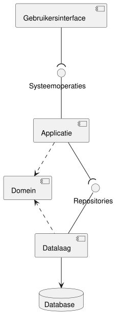

# Architectuur

Met de requirements uit de vorige hoofdstukken begint het ontwerp.
Dit hoofdstuk verdeelt ICDE in lagen en zet elke laag op een server.
De hoofdstukken [Klassendiagram](07-klassendiagram.md#klassendiagram) en
[Sequence diagrams](08-sequencediagrammen.md#sequence-diagrams) werken de applicatie en het domein
uit.

## Component diagram

De casus eist dat presentatielaag, domeinlaag en datalaag elk op een eigen server draaien.
Het component diagram toont de lagen en de interfaces ertussen.

| Component | Inhoud | Server |
| --- | --- | --- |
| Gebruikersinterface | Schermen, buiten dit ontwerp | Webserver |
| Applicatie | De handlers, package `applicatie` | Applicatieserver |
| Domein | Domeinklassen, regels, repository-interfaces, package `domein` | Applicatieserver |
| Datalaag | De implementatie van de repositories | Applicatieserver |
| Database | De gegevens | Databaseserver |

- Systeemoperaties zijn de operaties van de handlers.
  Het zijn de systeemoperaties uit de system sequence diagrams.
- Repositories zijn de interfaces OWERepository, OpleidingRepository,
  DocumentsjabloonRepository en VergrendelingRepository.
  Ze horen bij het domein, en de datalaag implementeert ze (K2).
  De datalaag hangt dus af van het domein, niet andersom.

## Keuzes

### A1 Waar draait de domeinlogica?

Probleem: de consistentieregels, de validatieregels en het genereren van documenten moeten ergens
draaien.
Meerdere gebruikers werken tegelijk aan dezelfde OWE.

Alternatieven:

- In de gebruikersinterface, met een server die alleen gegevens opslaat.
  Dan draait elke regel op elke client.
  Een latere koppeling met Brightspace of Osiris moet de regels opnieuw bouwen.
- In de database, als stored procedures en constraints.
  Een regel als BR5 (toetsen per week) is dan moeilijk te schrijven en te testen.
  De regels hangen dan af van één databaseproduct, en OO-patterns zoals Strategy zijn niet
  bruikbaar.

Keuze: een eigen applicatie- en domeinlaag op de applicatieserver.
Elke regel staat op één plaats, voor alle gebruikers en latere koppelingen.
Gebruikersinterface en database zijn vervangbaar zonder het domein te wijzigen (Low Coupling).
