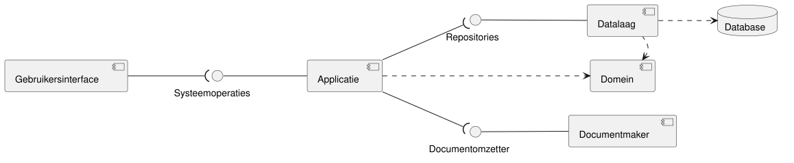

# Architectuur

Met de requirements uit de vorige hoofdstukken begint het ontwerp.
Dit hoofdstuk verdeelt ICDE in lagen en zet elke laag op een server.
De hoofdstukken [Klassendiagram](07-klassendiagram.md#klassendiagram) en
[Sequence diagrams](08-sequencediagrammen.md#sequence-diagrams) werken de applicatie en het domein
uit.

## Component diagram

Het component diagram toont de lagen en de interfaces ertussen.

| Component | Inhoud | Server |
| --- | --- | --- |
| Gebruikersinterface | Schermen, buiten dit ontwerp | Webserver |
| Applicatie | De handlers, package `applicatie` | Applicatieserver |
| Domein | Domeinklassen, regels, repository-interfaces, package `domein` | Applicatieserver |
| Datalaag | De implementatie van de repositories | Applicatieserver |
| Documentkoppeling | De implementatie van Documentomzetter | Applicatieserver |
| Database | De gegevens | Databaseserver |
| Documentmaker | Maakt van inhoud en opmaak een PDF- of Word-bestand | Documentserver |

- Systeemoperaties zijn de operaties van de handlers.
  Het zijn de systeemoperaties uit de system sequence diagrams.
- Repositories zijn de interfaces OWERepository, OpleidingRepository,
  DocumentsjabloonRepository en VergrendelingRepository.
  Ze horen bij het domein, en de datalaag implementeert ze (K2).
  De datalaag hangt dus af van het domein, niet andersom.
- Documentomzetter is een interface van het domein, en de documentkoppeling implementeert haar
  (A2, K5).
  De documentkoppeling roept de documentmaker aan over het netwerk.

## Keuzes

### A1 Waar draait de domeinlogica?

Probleem: de consistentieregels, de validatieregels en het genereren van documenten moeten ergens
draaien.
Meerdere gebruikers werken tegelijk aan dezelfde OWE.

Alternatieven:

- In de gebruikersinterface, met een server die alleen gegevens opslaat.
  Dan draait elke regel op elke client.
  Een latere koppeling met Brightspace of Osiris moet de regels opnieuw bouwen.
- In de database, als stored procedures en constraints.
  Een regel als BR5 (toetsen per week) is dan moeilijk te schrijven en te testen.
  De regels hangen dan af van één databaseproduct, en OO-patterns zoals Strategy zijn niet
  bruikbaar.

Keuze: een eigen applicatie- en domeinlaag op de applicatieserver.
Elke regel staat op één plaats, voor alle gebruikers en latere koppelingen.
Gebruikersinterface en database zijn vervangbaar zonder het domein te wijzigen (Low Coupling).

### A2 Waar wordt het bestand gemaakt?

Probleem: UC06 maakt van de inhoud van een OWE een PDF- of Word-bestand.
Dat is zwaar werk, en het voert de opmaak uit die de functioneel beheerder aanpast (UC10).

Alternatieven:

- In het domein: Documentsjabloon maakt zelf het bestand.
  Dan hangt het domein af van de programma's die het bestand maken, en is het moeilijk te testen.
- Op de applicatieserver, buiten het domein.
  Een trage of vastgelopen omzetting hindert dan alle andere use cases.
  Een fout in een sjabloon draait dan op de server die bij alle gegevens kan.

Keuze: een eigen documentserver, achter de interface Documentomzetter.

- De applicatieserver bestuurt: hij kent de regels en de gegevens.
  De documentserver rekent: hij krijgt inhoud en opmaak, en geeft een bestand terug.
- De documentserver bewaart niets en kan niet bij de database.
  Een fout in een sjabloon raakt dus geen gegevens.
- De interface hoort bij het domein, de implementatie bij de documentkoppeling, net als bij de
  repositories (Dependency Inversion Principle).
- De documentserver is vervangbaar zonder het domein te wijzigen (Low Coupling).

Gevolg: het maken van een bestand is een aanroep over het netwerk.
Is de documentserver niet bereikbaar, dan is er geen document gemaakt, zoals de postconditie bij
falen van UC06 zegt.
Dat is een technische fout, geen flow van de use case.
