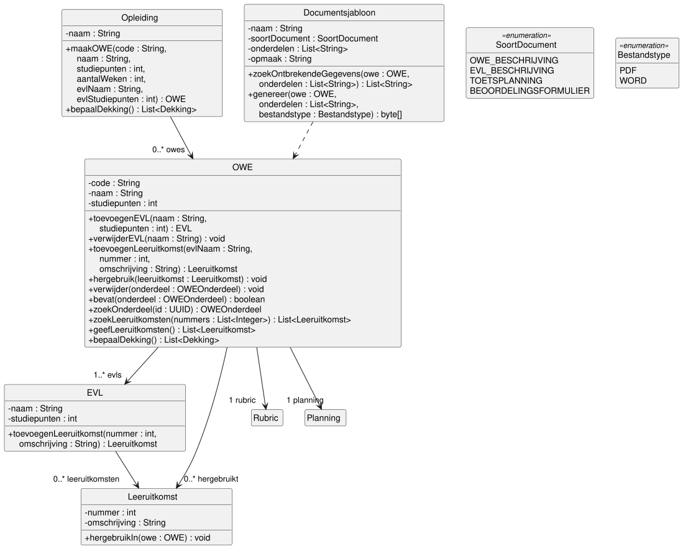
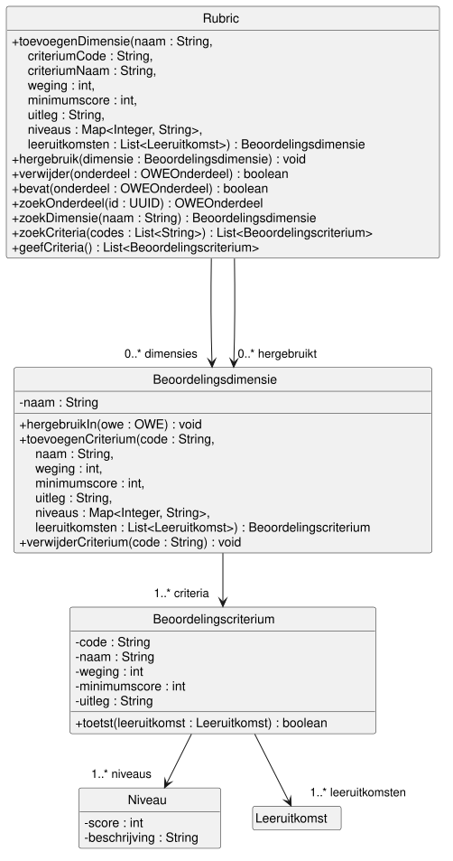
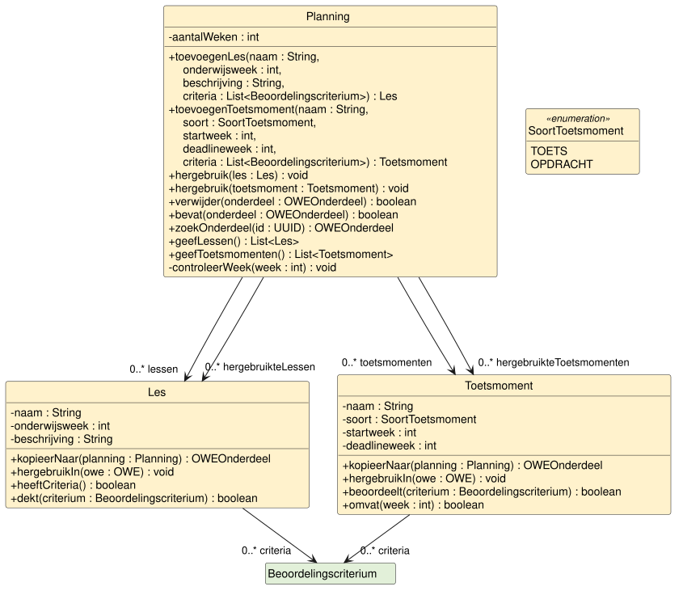
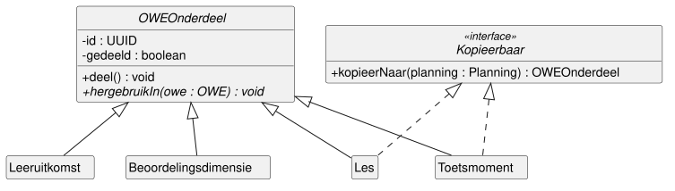
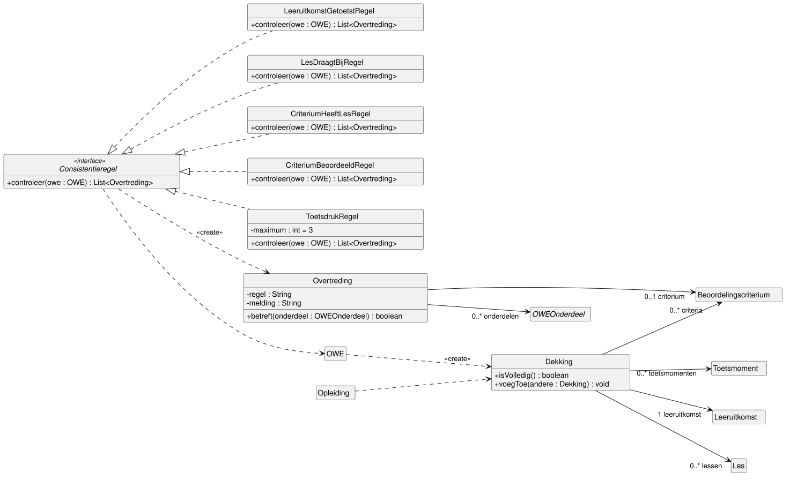
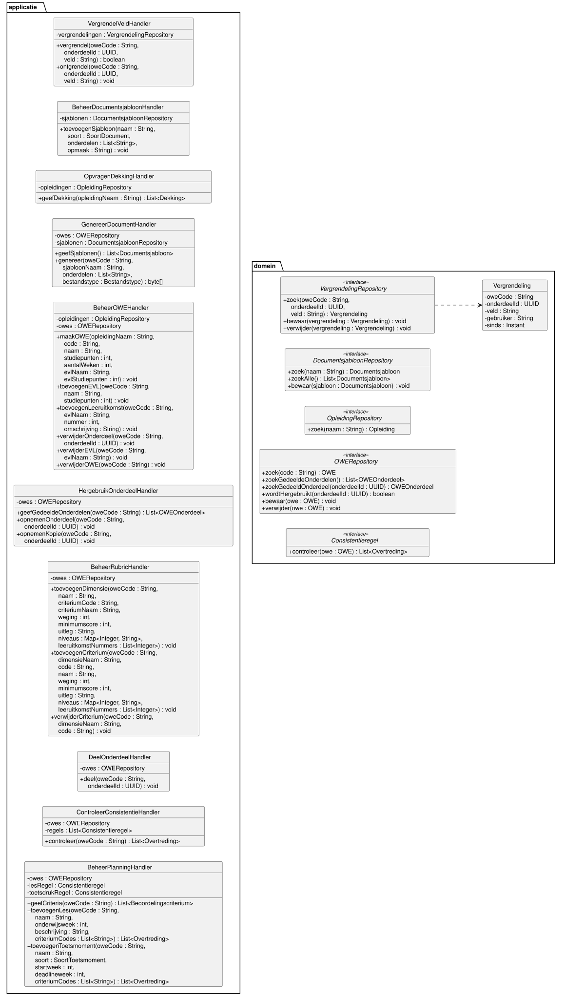

# Klassendiagram

Dit hoofdstuk werkt de applicatie- en domeinlaag uit als design class diagram (DCD).

## Aanpak

Een associatie heeft geen naam.
Multipliciteit en rolnaam staan alleen aan de doelkant (Larman 7.4).
De systeemoperaties komen uit de
[system sequence diagrams](08-sequencediagrammen.md#system-sequence-diagrams).
De GRASP-patterns verdelen de verantwoordelijkheden, en de sequence diagrams controleren het
ontwerp.

## Klassendiagrammen

Het ontwerp staat in zes diagrammen, zodat elk diagram leesbaar blijft.
Elke klasse staat in één diagram volledig, met attributen en operaties.
In een ander diagram staat ze alleen met haar naam.
Elke parameter van een operatie staat op een eigen regel.

De kleur van een klasse toont in welk diagram ze volledig staat.
Een klasse heeft in elk diagram dezelfde kleur.

| Kleur | Diagram waarin de klasse volledig staat |
| --- | --- |
| Blauw | OWE en documentsjabloon |
| Groen | Rubric |
| Geel | Planning |
| Oranje | OWEOnderdeel en hergebruik |
| Paars | Consistentieregels en dekking |
| Grijs | Handlers en repositories |

### OWE en documentsjabloon

OWE heeft de EVL's en leeruitkomsten, en één Rubric en één Planning (K9).

### Rubric

### Planning

### OWEOnderdeel en hergebruik

Leeruitkomst, Beoordelingsdimensie, Les en Toetsmoment zijn een OWEOnderdeel.
Alleen Les en Toetsmoment zijn Kopieerbaar (K6).

### Consistentieregels en dekking

### Handlers en repositories

## Van domeinmodel naar ontwerp

De elf concepten zijn elf klassen met dezelfde naam, zonder streepje: OWEOnderdeel.
Net als het domeinmodel gebruikt het klassendiagram geen compositie.
OWEOnderdeel krijgt een id (UUID), waarmee UC07 en UC09 een onderdeel aanwijzen.
Rubric en Planning zijn ontwerpklassen zonder concept in het domeinmodel (K9).
Het attribuut aantalWeken van OWE staat in Planning, omdat alleen de planning de looptijd gebruikt.

Elke associatie is navigeerbaar in één richting, van eigenaar naar onderdeel en van les of
toetsmoment naar criterium, zonder cyclus (Low Coupling).
Een vraag in de andere richting gaat naar een klasse met overzicht, zoals Planning voor de lessen
bij een criterium en OWERepository.wordtHergebruikt voor BR13.

## Keuzes

### K1 Een handler per use case

Probleem: ICDE heeft 11 use cases met samen meer dan 30 systeemoperaties.
Welke klasse ontvangt ze (GRASP Controller)?

Alternatieven:

- Eén facade controller ICDE.
  Alle operaties staan dan in één klasse, met lage cohesie (bloated controller).
- Een eigen handler voor elk van de 11 use cases.
  Vier handlers doen dan hetzelfde: een OWE ophalen, een onderdeel toevoegen en de OWE bewaren.

Keuze: een use case controller per use case, met het achtervoegsel Handler.
CRUD use cases van dezelfde actor over dezelfde gegevens delen een handler, tot ongeveer 10
systeemoperaties.

- UC01 en UC02 delen BeheerOWEHandler.
- UC04 en UC11 delen BeheerPlanningHandler.
- UC03 heeft met dimensies, criteria en niveaus genoeg operaties voor een eigen handler.

Use cases van verschillende actoren veranderen om verschillende redenen, en delen dus geen handler
(Single Responsibility Principle).

### K2 Repositories vinden de objecten

Probleem: een handler krijgt een code of naam en moet het object vinden.
De database draait op een eigen server.

Alternatieven:

- Een rootobject Catalogus, zoals Store bij Larman.
  Dat laadt alle opleidingen voor elke vraag.
- Statische zoekoperaties, zoals OWE.zoek(code).
  Dan kent elke domeinklasse de database, en is ze moeilijk te testen.

Keuze: een repository-interface per ingang: OWERepository, OpleidingRepository,
DocumentsjabloonRepository en VergrendelingRepository.
De interface hoort bij het domein, de implementatie bij de datalaag.
Zo hangt het domein niet af van de database (Dependency Inversion Principle).
Het data source pattern volgt in blok 2.

### K3 De delen van OWE geven alle gegevens

Probleem: de consistentieregels, de dekking en de documenten hebben alle leeruitkomsten,
criteria, lessen en toetsmomenten van een OWE nodig.
Daar horen ook de hergebruikte onderdelen bij.

Alternatief: elke regel zoekt zelf in EVL's, dimensies en hergebruik.
Dan kent elke regel de structuur van OWE.

Keuze: de klasse met de lijst geeft de gegevens (Information Expert).
OWE heeft geefLeeruitkomsten, Rubric geefCriteria, en Planning geefLessen en geefToetsmomenten.
Ze geven eigen en hergebruikte onderdelen samen, zodat de rest van het systeem het verschil niet
ziet (information hiding).

### K4 Een klasse per consistentieregel

Probleem: UC05 past BR1 tot en met BR5 toe.
De opdrachtgever kan regels toevoegen of wijzigen.

Alternatieven:

- Een operatie per regel in OWE.
  OWE krijgt dan meer taken, en elke nieuwe regel wijzigt OWE.
- Alle regels in ControleerConsistentieHandler.
  Dan staat domeinlogica in de handler, en kunnen UC04 en UC11 de regels niet hergebruiken.

Keuze: een interface Consistentieregel, met een klasse per regel.

- ControleerConsistentieHandler loopt de lijst regels af en weet niet welke regels er zijn.
- Een nieuwe regel is een nieuwe klasse, zonder wijziging van bestaande code (Open/Closed
  Principle).
- BeheerPlanningHandler hergebruikt LesDraagtBijRegel (BR2) en ToetsdrukRegel (BR5) in stap 6
  van UC04 en UC11.
- ToetsdrukRegel heeft het maximum als attribuut, dus een andere grens vraagt geen nieuwe klasse.

Deze opzet lijkt op het Strategy pattern.

### K5 Documentsjabloon maakt de inhoud van het document

Probleem: ICDE scheidt inhoud en vorm (UC06).
De functioneel beheerder wil sjablonen aanpassen zonder programmeur (UC10).
Het bestand zelf maakt de documentserver
([A2](06-architectuur.md#a2-waar-wordt-het-bestand-gemaakt)).

Alternatieven:

- OWE.genereer(sjabloon).
  OWE kent dan de opmaak, en dat is niet zijn taak (High Cohesion).
- Een generatorklasse per soort document.
  Een nieuwe soort document vraagt dan een programmeur.
- Documentsjabloon maakt ook het bestand.
  Dan roept een domeinklasse de documentserver aan, en is ze niet te testen zonder die server.

Keuze: Documentsjabloon maakt de inhoud, want het kent zijn onderdelen (Information Expert).
De interface Documentomzetter maakt van de inhoud een bestand.

- zoekOntbrekendeGegevens voert stap 4 uit.
  maakInhoud en Documentomzetter.zetOm voeren samen stap 5 uit.
- zoekOntbrekendeGegevens en maakInhoud krijgen de onderdelen die de ontwikkelaar in stap 3 koos.
  Een lege lijst betekent alle onderdelen van het sjabloon (flow 3A).
- maakInhoud geeft de inhoud als tekst terug, zonder opmaak.
- GenereerDocumentHandler geeft de inhoud, de opmaak van het sjabloon en het bestandstype aan
  zetOm.
- zetOm geeft de inhoud van een PDF- of Word-bestand terug, daarom byte[].
- Documentomzetter hoort bij het domein, de implementatie bij de documentkoppeling.
  Zo hangt het domein niet af van de documentserver (Dependency Inversion Principle), net als bij
  de repositories (K2).
- Documentsjabloon kent OWE alleen als parameter: een dependency, geen associatie.

Welke programma's de documentserver gebruikt, is een technologiekeuze voor blok 2.

### K6 Hergebruik: verwijzing of kopie

Probleem: UC07 neemt een gedeeld onderdeel op in een OWE, als verwijzing of als kopie.
Een verwijzing toont altijd de actuele versie (BR6).
Een kopie hangt niet meer af van het origineel (flow 3A), en kan alleen van een les of
toetsmoment.
Hoe komt een kopie in de OWE?

Alternatieven:

- De gebruikersinterface vult het toevoegscherm met het origineel.
  Flow 3A heeft die stap niet: het systeem neemt de kopie zelf op, zonder invoer van de
  ontwikkelaar.
- Een abstracte operatie kopieerNaar op OWEOnderdeel.
  Die geeft bij Leeruitkomst en Beoordelingsdimensie een fout, en dat schendt het Liskov
  Substitution Principle.
  Een gekopieerde leeruitkomst heeft een EVL en een nieuw nummer nodig (BR9).
  Een gekopieerd criterium verliest zijn leeruitkomsten, terwijl het er minstens één toetst.

Keuze: een interface Kopieerbaar met de operatie kopieerNaar(owe), die Les en Toetsmoment elk op
hun eigen manier uitwerken (Polymorphism).

- Stap 2: HergebruikOnderdeelHandler.geefGedeeldeOnderdelen haalt de gedeelde onderdelen op die
  de OWE nog niet bevat (OWE.bevat).
- Stap 4: de polymorfe operatie OWEOnderdeel.hergebruikIn(owe) voegt het originele object toe aan
  de lijst hergebruikt van zijn soort, dus de OWE ziet elke wijziging meteen.
  Een leeruitkomst gaat naar OWE, een dimensie naar Rubric, een les of toetsmoment naar Planning.
  Zo test de handler de soort niet (Polymorphism).
- Flow 3A: HergebruikOnderdeelHandler.opnemenKopie controleert dat het onderdeel Kopieerbaar is.
  Les.kopieerNaar roept planning.toevoegenLes aan, Toetsmoment.kopieerNaar
  planning.toevoegenToetsmoment.
  Zo controleert Planning BR11 en BR14 net als bij toevoegen, zonder de soort te testen
  ([S3](08-sequencediagrammen.md#s3-kopie-via-toevoegen)).
- De kopie heeft geen criteria, want die horen bij de andere OWE.
  UC05 meldt dat (BR2, BR4), en de ontwikkelaar koppelt daarna eigen criteria.
- Flow 4A: OWERepository.zoekGedeeldOnderdeel vindt een verwijderd origineel niet, en de handler
  meldt dat.

### K7 De eigenaar maakt een onderdeel

Probleem: welke klasse maakt een nieuw onderdeel (GRASP Creator)?

Alternatief: de handler maakt het onderdeel en geeft het aan de eigenaar.
Dan kent de handler de constructors van het domein, en controleert de eigenaar zijn regels pas
achteraf.

Keuze: de klasse die het onderdeel bevat.

| Klasse | Maakt |
| --- | --- |
| Opleiding | OWE, met de eerste EVL |
| OWE | EVL, Rubric en Planning |
| Rubric | Beoordelingsdimensie met het eerste criterium |
| Planning | Les en Toetsmoment |
| EVL | Leeruitkomst |
| Beoordelingsdimensie | Beoordelingscriterium |

Gevolgen:

- Opleiding.maakOWE krijgt de gegevens van de eerste EVL mee, want BR8 eist minstens één EVL.
  Zo bestaat er geen OWE zonder EVL.
- Rubric.toevoegenDimensie krijgt de gegevens van het eerste criterium mee, want een dimensie
  bestaat uit minstens één criterium (BR10).
- Verwijderen weigert het laatste exemplaar.
  OWE.verwijderEVL weigert de laatste EVL (BR8) en een EVL met leeruitkomsten (BR9).
  Beoordelingsdimensie.verwijderCriterium weigert het laatste criterium (BR10).
- De handler krijgt bij een les of toetsmoment de criteriumcodes, niet de criteria zelf.
  Rubric.zoekCriteria zoekt ze op in de eigen en hergebruikte dimensies van de OWE.
  Een code van een andere OWE vindt Rubric niet, en dat geeft een fout.
  Zo dwingt het ontwerp BR11 en BR14 af.
- De private operatie Planning.controleerWeek controleert onderwijsweek, startweek en
  deadlineweek (BR11, BR14).

### K8 Een vergrendeling per invoerveld

Probleem: twee ontwikkelaars wijzigen tegelijk dezelfde OWE.
De opdrachtgever wil dat een invoerveld geblokkeerd is zolang iemand het wijzigt.
De rest van de OWE blijft bewerkbaar.

Alternatieven:

- Een versienummer op OWE, en bewaar weigert een oude versie.
  Het conflict blijkt pas bij opslaan, en het werk van de tweede ontwikkelaar is verloren.
- De hele OWE vergrendelen.
  De tweede ontwikkelaar wacht dan, ook bij een ander veld.

Keuze: een Vergrendeling per veld.

- Gaat een ontwikkelaar een veld in, dan roept de gebruikersinterface
  VergrendelVeldHandler.vergrendel aan.
  Heeft een ander het veld al, dan geeft vergrendel false, en blijft het veld geblokkeerd.
- Invoer gaat real-time naar de backend, dus er is geen stap opslaan.
  Verlaat de ontwikkelaar het veld, dan volgt ontgrendel.
- onderdeelId is leeg voor een veld van de OWE zelf.
- De handler haalt de ingelogde gebruiker uit de sessie, niet uit een parameter.
  Zo kan een client geen veld van een ander ontgrendelen.

VergrendelVeldHandler is een eigen handler, omdat elke wijzig-use case hem gebruikt.

### K9 OWE splitsen in Rubric en Planning

Probleem: OWE had 19 operaties.
EVL's, rubric, lesplanning, toetsplanning, hergebruik en dekking stonden in één klasse.
Elke wijziging in een van die taken raakt OWE (lage cohesie).

Alternatieven:

- Alles in OWE laten.
  Dat volgt Information Expert, maar OWE wordt een god class.
- Gegevens en gedrag scheiden: OWE houdt de lijsten, een serviceklasse maakt en controleert de
  onderdelen.
  Dan bewaakt OWE zijn eigen gegevens niet meer (anemic domain model), en kent de service de
  lijsten van OWE.

Keuze: OWE splitsen naar taak, met het gedrag bij de gegevens.

- Rubric beheert de beoordelingsdimensies en zoekt criteria op (BR10).
- Planning beheert de lessen en toetsmomenten en controleert de weken (BR11, BR14).
- OWE houdt de EVL's en leeruitkomsten (BR8, BR9) en de dekking.
- Rubric en Planning hebben elk een eigen verwijder, bevat en zoekOnderdeel, voor de eigen en
  hergebruikte onderdelen in hun lijsten (Information Expert).
- OWE.verwijder, bevat en zoekOnderdeel doorzoeken de leeruitkomsten van OWE, en vragen daarna
  Rubric en Planning.
  OWE kent de lijsten van Rubric en Planning dus niet.
  verwijder en bevat geven bij Rubric en Planning een boolean terug.
  Zo weet OWE of het onderdeel gevonden is, zonder de soort te testen.
- OWE maakt Rubric en Planning en heeft er precies één van (Creator).

Rubric en Planning zijn Pure Fabrication: het domeinmodel kent ze niet.
De namen komen wel uit de casus: de rubric van een OWE en de toetsplanning.
OWE heeft nu 10 operaties, Rubric 8 en Planning 10.

Gevolg: het domeinmodel heeft één associatie hergebruikt naar OWEOnderdeel.
Het ontwerp splitst die in een lijst per soort, bij het deel dat die soort beheert.
OWEOnderdeel.hergebruikIn kiest de lijst, zodat geen klasse de soort test (K6).

## Traceerbaarheid

### Per use case

| Use case | Handler | Klassen en operaties |
| --- | --- | --- |
| UC01 | BeheerOWEHandler | Opleiding.maakOWE, OWE.toevoegenEVL, OWE.verwijderEVL |
| UC02 | BeheerOWEHandler | OWE.toevoegenLeeruitkomst, EVL.toevoegenLeeruitkomst |
| UC03 | BeheerRubricHandler | Rubric.toevoegenDimensie, Beoordelingsdimensie.toevoegenCriterium |
| UC04 | BeheerPlanningHandler | Rubric.zoekCriteria, Planning.toevoegenLes, LesDraagtBijRegel |
| UC05 | ControleerConsistentieHandler | Consistentieregel met vijf regels, Overtreding |
| UC06 | GenereerDocumentHandler | Documentsjabloon.maakInhoud, Documentomzetter.zetOm |
| UC07 | HergebruikOnderdeelHandler | OWE.bevat, OWEOnderdeel.hergebruikIn, kopieerNaar |
| UC08 | OpvragenDekkingHandler | Opleiding.bepaalDekking, OWE.bepaalDekking, Dekking.voegToe |
| UC09 | DeelOnderdeelHandler | OWEOnderdeel.deel |
| UC10 | BeheerDocumentsjabloonHandler | Documentsjabloon |
| UC11 | BeheerPlanningHandler | Planning.toevoegenToetsmoment, ToetsdrukRegel |

De namen van de use cases staan in het [overzicht use cases](03-use-cases.md#overzicht-use-cases).

Verwijderen gaat zo:

- Een leeruitkomst, dimensie, les of toetsmoment: BeheerOWEHandler.verwijderOnderdeel en
  OWE.verwijder.
  Eén operatie is genoeg, omdat het allemaal een OWEOnderdeel is.
  OWE geeft de vraag door aan Rubric en Planning (K9).
- Een criterium is geen OWEOnderdeel: BeheerRubricHandler.verwijderCriterium en
  Beoordelingsdimensie.verwijderCriterium.
- Een EVL is geen OWEOnderdeel: BeheerOWEHandler.verwijderEVL en OWE.verwijderEVL.
- Een OWE: BeheerOWEHandler.verwijderOWE en OWERepository.verwijder.

### Per bedrijfsregel

Per regel de klasse die de regel controleert, en het sequence diagram (SD) dat de regel toont.
De regels zonder SD horen bij CRUD use cases, zie de
[aanpak van de sequence diagrams](08-sequencediagrammen.md#aanpak).

| Regel | Klasse en operatie | SD |
| --- | --- | --- |
| BR1 | LeeruitkomstGetoetstRegel, met Beoordelingscriterium.toetst | BR1 |
| BR2 | LesDraagtBijRegel, met Les.heeftCriteria | controleer, toevoegenLes |
| BR3 | CriteriumHeeftLesRegel, met Les.dekt | controleer |
| BR4 | CriteriumBeoordeeldRegel, met Toetsmoment.beoordeelt | controleer |
| BR5 | ToetsdrukRegel, met Toetsmoment.omvat | BR5, toevoegenToetsmoment |
| BR6 | OWEOnderdeel.hergebruikIn bewaart een verwijzing, geen kopie | opnemenOnderdeel |
| BR7 | Alleen de OWE die het onderdeel in de eigen lijsten heeft, wijzigt het | - |
| BR8 | Opleiding.maakOWE met de eerste EVL, OWE.verwijderEVL, OWERepository.zoek | - |
| BR9 | EVL.toevoegenLeeruitkomst, met OWE voor een uniek nummer | - |
| BR10 | Rubric.toevoegenDimensie, Beoordelingsdimensie.toevoegenCriterium, verwijderCriterium | - |
| BR11 | Planning.toevoegenLes, controleerWeek, Rubric.zoekCriteria | toevoegenLes, opnemenKopie |
| BR12 | BeheerDocumentsjabloonHandler, met DocumentsjabloonRepository.zoek | - |
| BR13 | verwijderOnderdeel, verwijderCriterium, verwijderOWE, OWERepository.wordtHergebruikt | - |
| BR14 | Planning.toevoegenToetsmoment, controleerWeek, Rubric.zoekCriteria | toevoegenToetsmoment |

## Wat niet in de diagrammen staat

- Getters en setters, omdat ze weinig informatie toevoegen (Larman 7.6).
- Constructors, omdat de maak-operaties al tonen wie wat maakt (K7).
- Wijzigen en bekijken bij de CRUD use cases, met dezelfde parameters als toevoegen.
- Foutmeldingen: een validatieregel of exceptional flow gooit een OngeldigeInvoerException,
  zoals flow 2A van UC05 en flow 4A van UC04, UC06, UC07 en UC11.
- De gebruikersinterface en de implementatie van de repositories en van Documentomzetter, die bij
  blok 2 horen.
