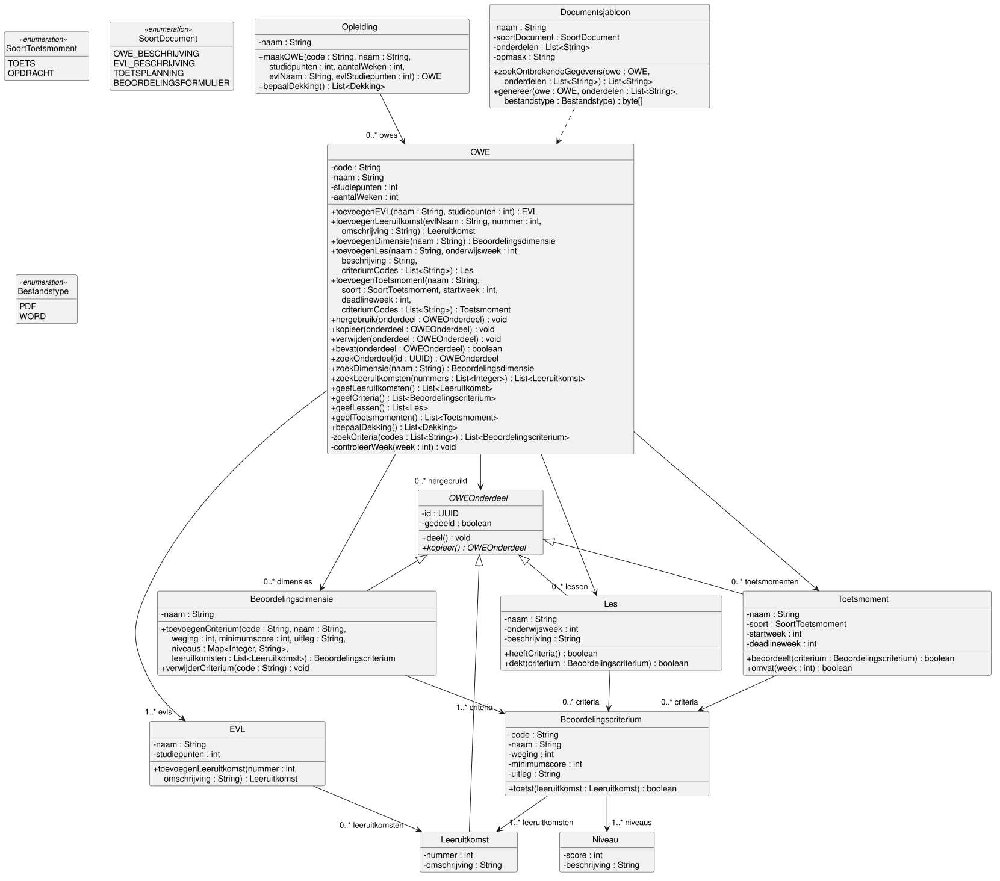
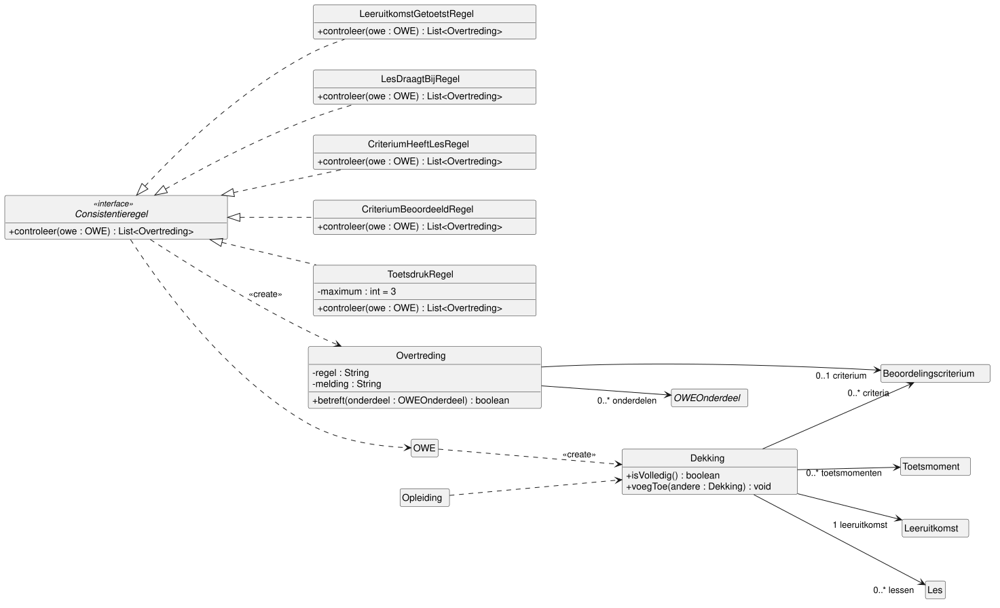
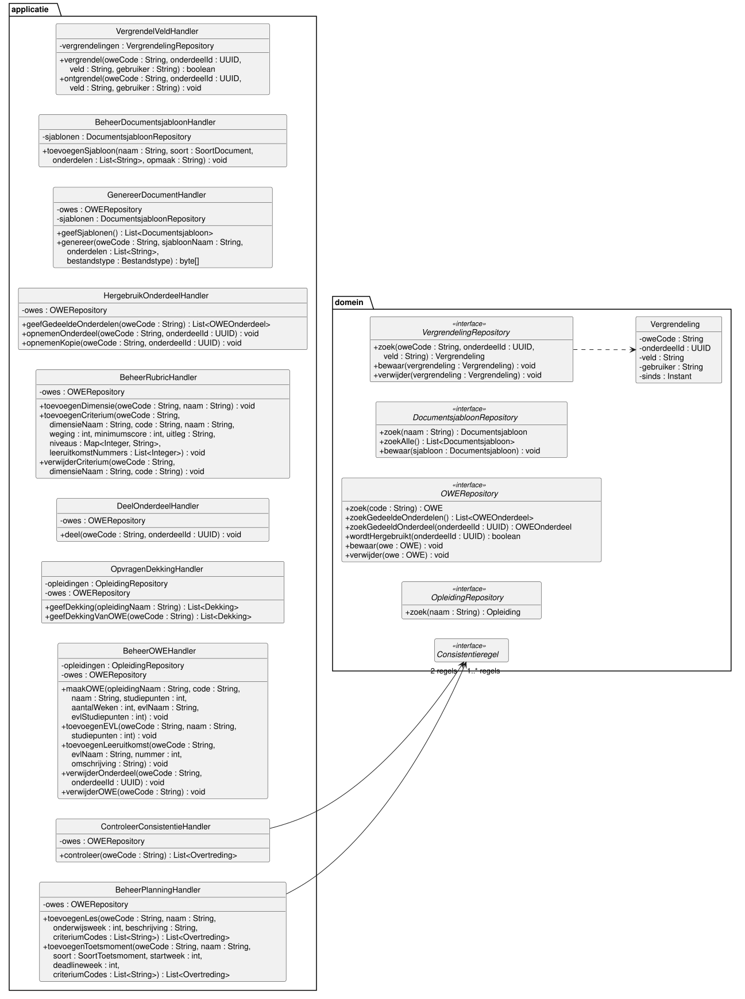

# Klassendiagram

Dit hoofdstuk werkt de applicatie- en domeinlaag uit als design class diagram (DCD).

## Aanpak

Een associatie heeft geen naam.
Multipliciteit en rolnaam staan alleen aan de doelkant (Larman 7.4).
De systeemoperaties komen uit de
[system sequence diagrams](08-sequencediagrammen.md#system-sequence-diagrams).
De GRASP-patterns verdelen de verantwoordelijkheden, en de sequence diagrams controleren het
ontwerp.

## Klassendiagrammen

Het ontwerp staat in drie diagrammen, zodat elk diagram leesbaar blijft.

### Domeinklassen

### Consistentieregels en dekking

### Handlers en repositories

## Van domeinmodel naar ontwerp

De elf concepten zijn elf klassen met dezelfde naam, zonder streepje: OWEOnderdeel.
Net als het domeinmodel gebruikt het klassendiagram geen compositie (D4).

| Wat | Domeinmodel | Klassendiagram |
| --- | --- | --- |
| Attributen | Alleen een naam | Visibility private en een datatype |
| Operaties | Geen | Uit de stappen van de use cases |
| Associaties | Naam, geen richting | Pijl, rolnaam en multipliciteit aan de doelkant |
| soort, soortDocument | Een attribuut | Enumeraties SoortToetsmoment en SoortDocument |
| onderdelen, volgorde | Twee attributen van Documentsjabloon | Eén geordende lijst onderdelen |
| Bestandstype | Geen attribuut | Enumeratie Bestandstype, een parameter van UC06 |
| OWE-onderdeel | Alleen gedeeld | Ook een id (UUID), uniek over alle OWE's heen |
| Nieuwe klassen | Geen | Handlers, repositories, regels, Overtreding, Dekking, Vergrendeling |
| Kopieerbaar | Geen | Interface voor de onderdelen die UC07 kan kopiëren |

Met het id wijzen UC07 en UC09 een onderdeel aan.

## Keuzes

### K1 Een handler per use case

Probleem: ICDE heeft 11 use cases met samen meer dan 30 systeemoperaties.
Welke klasse ontvangt ze (GRASP Controller)?

Alternatieven:

- Eén facade controller ICDE.
  Alle operaties staan dan in één klasse, met lage cohesie (bloated controller).
- Een eigen handler voor elk van de 11 use cases.
  Vier handlers doen dan hetzelfde: een OWE ophalen, een onderdeel toevoegen en de OWE bewaren.

Keuze: een use case controller per use case, met het achtervoegsel Handler.
CRUD use cases van dezelfde actor over dezelfde gegevens delen een handler, tot ongeveer 10
systeemoperaties.

- UC01 en UC02 delen BeheerOWEHandler.
- UC04 en UC11 delen BeheerPlanningHandler.
- UC03 heeft met dimensies, criteria en niveaus genoeg operaties voor een eigen handler.

Use cases van verschillende actoren veranderen om verschillende redenen, en delen dus geen handler
(Single Responsibility Principle).

### K2 Repositories vinden de objecten

Probleem: een handler krijgt een code of naam en moet het object vinden.
De database draait op een eigen server, zoals de casus eist.

Alternatieven:

- Een rootobject Catalogus, zoals Store bij Larman.
  Dat laadt alle opleidingen voor elke vraag.
- Statische zoekoperaties, zoals OWE.zoek(code).
  Dan kent elke domeinklasse de database, en is ze moeilijk te testen.

Keuze: een repository-interface per ingang: OWERepository, OpleidingRepository,
DocumentsjabloonRepository en VergrendelingRepository.
De interface hoort bij het domein, de implementatie bij de datalaag.
Zo hangt het domein niet af van de database (Dependency Inversion Principle).
Het data source pattern volgt in blok 2.

### K3 Associaties in één richting

Probleem: welke kant van een associatie is navigeerbaar?

Alternatief: beide richtingen.
Dat is een dubbele koppeling, en beide kanten moeten gelijk blijven.

Keuze: elke associatie gaat één kant op, van eigenaar naar onderdeel en van les of toetsmoment
naar criterium (Low Coupling).
Er is geen cyclus.
Een vraag in de andere richting gaat naar een klasse met overzicht:

- "Welke lessen dragen bij aan dit criterium?" beantwoordt OWE, want die kent alle lessen.
- "Hergebruikt een andere OWE dit onderdeel?" (BR13) beantwoordt
  OWERepository.wordtHergebruikt.
- "Welke onderdelen zijn gedeeld?" (UC07) beantwoordt OWERepository.zoekGedeeldeOnderdelen.

### K4 OWE geeft alle gegevens van een OWE

Probleem: de consistentieregels, de dekking en de documenten hebben alle leeruitkomsten,
criteria, lessen en toetsmomenten van een OWE nodig.
Daar horen ook de hergebruikte onderdelen bij.

Alternatief: elke regel zoekt zelf in EVL's, dimensies en hergebruik.
Dan kent elke regel de structuur van OWE.

Keuze: OWE heeft geefLeeruitkomsten, geefCriteria, geefLessen en geefToetsmomenten (Information
Expert).
Ze geven eigen en hergebruikte onderdelen samen, zodat de rest van het systeem het verschil niet
ziet (information hiding).
Nadeel: OWE heeft 19 operaties.
[S4](08-sequencediagrammen.md#s4-owe-blijft-één-klasse) weegt dat af.

### K5 Een klasse per consistentieregel

Probleem: UC05 past BR1 tot en met BR5 toe.
De opdrachtgever kan regels toevoegen of wijzigen, zie
[Open punten en overdracht](10-open-punten.md#requirements).

Alternatieven:

- Een operatie per regel in OWE.
  OWE krijgt dan meer taken, en elke nieuwe regel wijzigt OWE.
- Alle regels in ControleerConsistentieHandler.
  Dan staat domeinlogica in de handler, en kunnen UC04 en UC11 de regels niet hergebruiken.

Keuze: een interface Consistentieregel, met een klasse per regel.

- ControleerConsistentieHandler loopt de lijst regels af en weet niet welke regels er zijn.
- Een nieuwe regel is een nieuwe klasse, zonder wijziging van bestaande code (Open/Closed
  Principle).
- BeheerPlanningHandler hergebruikt LesDraagtBijRegel (BR2) en ToetsdrukRegel (BR5) in stap 6
  van UC04 en UC11.
- ToetsdrukRegel heeft het maximum als attribuut, dus een andere grens vraagt geen nieuwe klasse.

Deze opzet lijkt op het Strategy pattern.

### K6 Documentsjabloon maakt het document

Probleem: ICDE scheidt inhoud en vorm (UC06).
De functioneel beheerder wil sjablonen aanpassen zonder programmeur (UC10).

Alternatieven:

- OWE.genereer(sjabloon).
  OWE kent dan de opmaak, en dat is niet zijn taak (High Cohesion).
- Een generatorklasse per soort document.
  Een nieuwe soort document vraagt dan een programmeur.

Keuze: Documentsjabloon maakt het document, want het kent zijn onderdelen en opmaak
(Information Expert).

- zoekOntbrekendeGegevens voert stap 4 uit, genereer stap 5.
- Beide krijgen de onderdelen die de ontwikkelaar in stap 3 koos.
  Een lege lijst betekent alle onderdelen van het sjabloon (flow 3A).
- genereer geeft de inhoud van een PDF- of Word-bestand terug, daarom byte[].
- Documentsjabloon kent OWE alleen als parameter: een dependency, geen associatie.

Welke template-engine het bestand maakt, is een technologiekeuze voor blok 2.

### K7 Hergebruik: verwijzing of kopie

Probleem: UC07 neemt een gedeeld onderdeel op in een OWE, als verwijzing of als kopie.
Een verwijzing toont altijd de actuele versie (BR6).
Een kopie hangt niet meer af van het origineel (flow 3A), en kan alleen van een les of
toetsmoment.
Hoe komt een kopie in de OWE?

Alternatieven:

- De gebruikersinterface vult het toevoegscherm met het origineel.
  Flow 3A heeft die stap niet: het systeem neemt de kopie zelf op, zonder invoer van de
  ontwikkelaar.
- Een abstracte operatie kopieerNaar op OWEOnderdeel.
  Die geeft bij Leeruitkomst en Beoordelingsdimensie een fout, en dat schendt het Liskov
  Substitution Principle.
  Een gekopieerde leeruitkomst heeft een EVL en een nieuw nummer nodig (BR9).
  Een gekopieerd criterium verliest zijn leeruitkomsten, terwijl het er minstens één toetst.

Keuze: een interface Kopieerbaar met de operatie kopieerNaar(owe), die Les en Toetsmoment elk op
hun eigen manier uitwerken (Polymorphism).

- Stap 2: HergebruikOnderdeelHandler.geefGedeeldeOnderdelen haalt de gedeelde onderdelen op die
  de OWE nog niet bevat (OWE.bevat).
- Stap 4: OWE.hergebruik voegt het originele object toe aan de lijst hergebruikt, dus de OWE ziet
  elke wijziging meteen.
- Flow 3A: HergebruikOnderdeelHandler.opnemenKopie controleert dat het onderdeel Kopieerbaar is.
  Les.kopieerNaar roept owe.toevoegenLes aan, Toetsmoment.kopieerNaar owe.toevoegenToetsmoment.
  Zo controleert OWE BR11 en BR14 net als bij toevoegen, zonder de soort te testen
  ([S3](08-sequencediagrammen.md#s3-kopie-via-toevoegen)).
- De kopie heeft geen criteria, want die horen bij de andere OWE.
  UC05 meldt dat (BR2, BR4), en de ontwikkelaar koppelt daarna eigen criteria.
- Flow 4A: OWERepository.zoekGedeeldOnderdeel vindt een verwijderd origineel niet, en de handler
  meldt dat.

### K8 De eigenaar maakt een onderdeel

Probleem: welke klasse maakt een nieuw onderdeel (GRASP Creator)?

Alternatief: de handler maakt het onderdeel en geeft het aan de eigenaar.
Dan kent de handler de constructors van het domein, en controleert de eigenaar zijn regels pas
achteraf.

Keuze: de klasse die het onderdeel bevat.

| Klasse | Maakt |
| --- | --- |
| Opleiding | OWE, met de eerste EVL |
| OWE | EVL, Beoordelingsdimensie met het eerste criterium, Les en Toetsmoment |
| EVL | Leeruitkomst |
| Beoordelingsdimensie | Beoordelingscriterium |

Gevolgen:

- Opleiding.maakOWE krijgt de gegevens van de eerste EVL mee, want BR8 eist minstens één EVL.
  Zo bestaat er geen OWE zonder EVL.
- OWE.toevoegenDimensie krijgt de gegevens van het eerste criterium mee, want een dimensie
  bestaat uit minstens één criterium (BR10).
- Verwijderen weigert het laatste exemplaar.
  OWE.verwijderEVL weigert de laatste EVL (BR8) en een EVL met leeruitkomsten (BR9).
  Beoordelingsdimensie.verwijderCriterium weigert het laatste criterium (BR10).
- OWE krijgt bij een les of toetsmoment de criteriumcodes, niet de criteria zelf.
  OWE zoekt ze op in de eigen en hergebruikte dimensies (zoekCriteria).
  Een code van een andere OWE vindt OWE niet, en dat geeft een fout.
  Zo dwingt het ontwerp BR11 en BR14 af.
- De private operatie controleerWeek controleert onderwijsweek, startweek en deadlineweek
  (BR11, BR14).

### K9 Een vergrendeling per invoerveld

Probleem: twee ontwikkelaars wijzigen tegelijk dezelfde OWE.
De opdrachtgever wil dat een invoerveld geblokkeerd is zolang iemand het wijzigt.
De rest van de OWE blijft bewerkbaar.

Alternatieven:

- Een versienummer op OWE, en bewaar weigert een oude versie.
  Het conflict blijkt pas bij opslaan, en het werk van de tweede ontwikkelaar is verloren.
- De hele OWE vergrendelen.
  De tweede ontwikkelaar wacht dan, ook bij een ander veld.

Keuze: een Vergrendeling per veld.

- Gaat een ontwikkelaar een veld in, dan roept de gebruikersinterface
  VergrendelVeldHandler.vergrendel aan.
  Heeft een ander het veld al, dan geeft vergrendel false, en blijft het veld geblokkeerd.
- Invoer gaat real-time naar de backend, dus er is geen stap opslaan.
  Verlaat de ontwikkelaar het veld, dan volgt ontgrendel.
- onderdeelId is leeg voor een veld van de OWE zelf.
- De handler haalt de ingelogde gebruiker uit de sessie, niet uit een parameter.
  Zo kan een client geen veld van een ander ontgrendelen.

VergrendelVeldHandler is een eigen handler, omdat elke wijzig-use case hem gebruikt.

## Traceerbaarheid

### Per use case

| Use case | Handler | Klassen en operaties |
| --- | --- | --- |
| UC01 | BeheerOWEHandler | Opleiding.maakOWE, OWE.toevoegenEVL, OWE.verwijderEVL |
| UC02 | BeheerOWEHandler | OWE.toevoegenLeeruitkomst, EVL.toevoegenLeeruitkomst |
| UC03 | BeheerRubricHandler | OWE.toevoegenDimensie, Beoordelingsdimensie.toevoegenCriterium |
| UC04 | BeheerPlanningHandler | OWE.toevoegenLes, LesDraagtBijRegel |
| UC05 | ControleerConsistentieHandler | Consistentieregel met vijf regels, Overtreding |
| UC06 | GenereerDocumentHandler | Documentsjabloon.zoekOntbrekendeGegevens, genereer |
| UC07 | HergebruikOnderdeelHandler | OWE.bevat, OWE.hergebruik, Kopieerbaar.kopieerNaar |
| UC08 | OpvragenDekkingHandler | Opleiding.bepaalDekking, OWE.bepaalDekking, Dekking.voegToe |
| UC09 | DeelOnderdeelHandler | OWEOnderdeel.deel |
| UC10 | BeheerDocumentsjabloonHandler | Documentsjabloon |
| UC11 | BeheerPlanningHandler | OWE.toevoegenToetsmoment, ToetsdrukRegel |

De namen van de use cases staan in het [overzicht use cases](03-use-cases.md#overzicht-use-cases).

Verwijderen gaat zo:

- Een leeruitkomst, dimensie, les of toetsmoment: BeheerOWEHandler.verwijderOnderdeel en
  OWE.verwijder.
  Eén operatie is genoeg, omdat het allemaal een OWEOnderdeel is.
- Een criterium is geen OWEOnderdeel: BeheerRubricHandler.verwijderCriterium en
  Beoordelingsdimensie.verwijderCriterium.
- Een EVL is geen OWEOnderdeel: BeheerOWEHandler.verwijderEVL en OWE.verwijderEVL.
- Een OWE: BeheerOWEHandler.verwijderOWE en OWERepository.verwijder.

### Per bedrijfsregel

Per regel de klasse die de regel controleert, en het sequence diagram (SD) dat de regel toont.
De regels zonder SD horen bij CRUD use cases, zie de
[aanpak van de sequence diagrams](08-sequencediagrammen.md#aanpak).

| Regel | Klasse en operatie | SD |
| --- | --- | --- |
| BR1 | LeeruitkomstGetoetstRegel, met Beoordelingscriterium.toetst | BR1 |
| BR2 | LesDraagtBijRegel, met Les.heeftCriteria | controleer, toevoegenLes |
| BR3 | CriteriumHeeftLesRegel, met Les.dekt | controleer |
| BR4 | CriteriumBeoordeeldRegel, met Toetsmoment.beoordeelt | controleer |
| BR5 | ToetsdrukRegel, met Toetsmoment.omvat | BR5, toevoegenToetsmoment |
| BR6 | OWE.hergebruik bewaart een verwijzing, geen kopie | opnemenOnderdeel |
| BR7 | Alleen de OWE die het onderdeel in de eigen lijsten heeft, wijzigt het | - |
| BR8 | Opleiding.maakOWE met de eerste EVL, OWE.verwijderEVL, OWERepository.zoek | - |
| BR9 | EVL.toevoegenLeeruitkomst, met OWE voor een uniek nummer | - |
| BR10 | OWE.toevoegenDimensie, Beoordelingsdimensie.toevoegenCriterium, verwijderCriterium | - |
| BR11 | OWE.toevoegenLes, met controleerWeek en zoekCriteria | toevoegenLes, opnemenKopie |
| BR12 | BeheerDocumentsjabloonHandler, met DocumentsjabloonRepository.zoek | - |
| BR13 | verwijderOnderdeel, verwijderCriterium, verwijderOWE, OWERepository.wordtHergebruikt | - |
| BR14 | OWE.toevoegenToetsmoment, met controleerWeek en zoekCriteria | toevoegenToetsmoment |

## Wat niet in de diagrammen staat

- Getters en setters, omdat ze weinig informatie toevoegen (Larman 7.6).
- Constructors, omdat de maak-operaties al tonen wie wat maakt (K8).
- Wijzigen en bekijken bij de CRUD use cases, met dezelfde parameters als toevoegen.
- Foutmeldingen: een validatieregel of exceptional flow gooit een OngeldigeInvoerException,
  zoals flow 2A van UC05 en flow 4A van UC04, UC06, UC07 en UC11.
- De gebruikersinterface en de implementatie van de repositories, die bij blok 2 horen.
