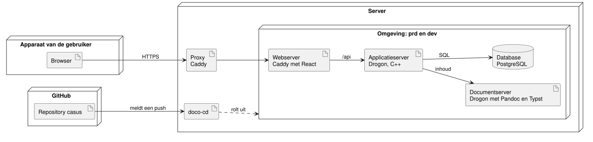
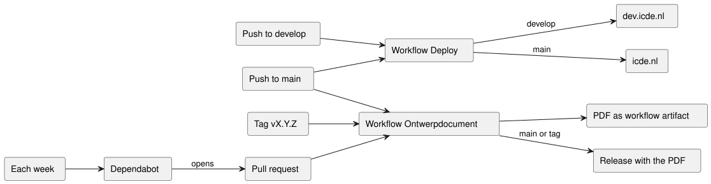
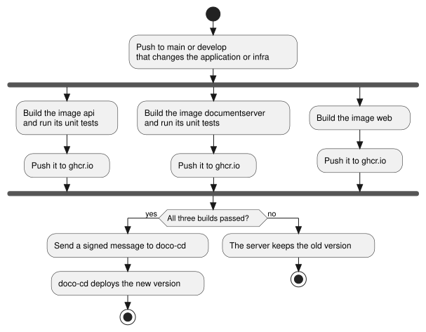
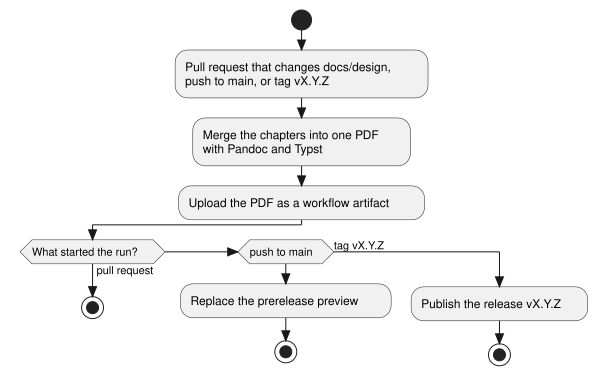

# Deployment

What GitHub does by itself, and how a change reaches the server.
[Server](server.md) describes the server itself.

## Environments

| Environment | Address | Branch |
| --- | --- | --- |
| Production | `https://icde.nl`, also `https://prd.icde.nl` | `main` |
| Development | `https://dev.icde.nl` | `develop` |

The server runs three Compose projects.
doco-cd deploys all three.

| Project | Contents | Branch |
| --- | --- | --- |
| `icde-prd` | Web server, application server, document server, database | `main` |
| `icde-dev` | The same four, with their own database | `develop` |
| `infra` | Proxy (Caddy), doco-cd, Beszel, Pocket ID | `main` |

Only the proxy is open to the internet.
It gets the certificates and passes each name to the right container.

## Automation

| Automation | Starts on | Result |
| --- | --- | --- |
| Workflow `Deploy` | Push to `main` or `develop` | New version on the server |
| Workflow `Ontwerpdocument` | Pull request, push to `main`, tag | The design document as PDF |
| Dependabot | Each week | Pull request with new versions |

The workflows are in `.github/workflows/`, the settings of Dependabot in `.github/dependabot.yml`.
The tab `Actions` on GitHub shows every run, with the log of each step.
Both workflows have a button `Run workflow` there, to start a run by hand.

A pull request does not build the application yet.
A broken build shows up only after the merge, in the workflow `Deploy`.

## From push to new version

1. A pull request merges to `main` or `develop`.
2. The workflow `Deploy` builds the images and pushes them to `ghcr.io`.
3. The workflow sends a signed message to doco-cd.
4. doco-cd checks the signature and fetches the commit.
5. doco-cd pulls the images and starts the stack.

doco-cd also checks GitHub each hour, in case a message is lost.
An update of `infra` can replace doco-cd itself.

### The workflow Deploy

The job `build` runs three times at once, each for one image.
The two C++ builds run the unit tests, so a failing test stops the workflow.
A build cache makes a later run faster than the first.

| Image | Built from |
| --- | --- |
| `icde-web` | `web/` |
| `icde-api` | `api/` |
| `icde-documentserver` | `documentserver/` |

The images go to `ghcr.io/han-craftsmanship-kl-jjg`.
The packages must be public, so the server pulls them without a login.
An image gets the tag `develop` on the branch `develop`, and `main` on every other branch.
A new build moves the tag, so the server always pulls the newest image of its branch.

The job `notify` runs only when all three builds pass.

Three more rules:

- The workflow starts only when a commit changes `compose.server.yaml`, a `.doco-cd` file,
  `api/`, `documentserver/`, `web/`, `db/` or `infra/`.
  A change in the documentation deploys nothing.
- One run at a time.
  A second run waits until the first is done.
- When you start a run by hand, pick `main` or `develop`.
  A run from another branch would build the tag `main`.

### What a deployment keeps

- Containers without a change keep running.
- The data in the database stays, because it lives in a named volume.
- A change in `db/schema.sql` does not reach an existing database, see [Server](server.md#files).
- `infra` deploys from `main` only.
  A change in `infra/` on `develop` waits until it reaches `main`.

### Check a deployment

1. Look at the run of `Deploy` in the tab `Actions`.
   A red job `build` means the code did not build or a test failed.
   A red job `notify` means doco-cd did not accept the message.
2. Open the site and check the change.
3. On the server, `docker compose -p infra logs doco-cd` shows what doco-cd did.
4. `docker ps` shows each container with its health: `healthy`, `starting` or `unhealthy`.

<https://monitor.icde.nl> shows the load of each container.

### Undo a deployment

Revert the commit with a pull request to the same branch.
The workflow then builds and deploys the previous code.
There is no button to go back to an older image, because each build replaces the tag.

## Design document

The workflow `Ontwerpdocument` merges the chapters in `docs/design/` into one PDF, in filename
order.
It uses the image `pandoc/typst`.

| Started by | Where the PDF goes |
| --- | --- |
| Pull request that changes `docs/design/` | Workflow artifact, at the bottom of the run page |
| Push to `main` | Workflow artifact, and the prerelease `preview` |
| Tag `vX.Y.Z` | Workflow artifact, and the release `vX.Y.Z` |

Only one `preview` exists: each push to `main` replaces it.
The PDF shows the tag as its version, or the short commit hash when there is no tag.

## Dependency updates

Dependabot is a service of GitHub, not a workflow.
[Working agreements](werkafspraken.md#dependency-updates) describes what it updates and how to
review its pull requests.

## Laptop and server

| | Laptop | Server |
| --- | --- | --- |
| File | `compose.yaml` | `compose.server.yaml` |
| Address | `http://localhost:8080` | `https://icde.nl` or `https://dev.icde.nl` |
| Images | Built on the laptop | Pulled from `ghcr.io` |
| Started by | The developer | doco-cd |

## Security

doco-cd starts whatever the Compose files say.
Whoever can change a watched branch controls the server.

- doco-cd watches only `main` and `develop`, which change only through a pull request.
- The secret `WEBHOOK_SECRET` signs the message to doco-cd.
  It lives in the GitHub environments `production` and `development`, so only the workflow
  `Deploy` on those branches can use it.
- Secrets live in GitHub and on the server, not in the repository.
- Both environments share one doco-cd, so a change on `develop` can also reach production.
  That is accepted for a prototype.

## DNS

The domain is registered at mijn.host.
The records `icde.nl` and `*.icde.nl` (A and AAAA) point to the server.
