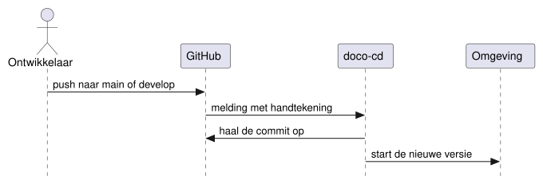

# Deployment

How a change reaches the server.
[Server](server.md) describes the server itself.

## Environments

| Environment | Address | Branch |
| --- | --- | --- |
| Production | `https://icde.nl`, also `https://prd.icde.nl` | `main` |
| Development | `https://dev.icde.nl` | `develop` |

The server runs three Compose projects.
doco-cd deploys all three.

| Project | Contents | Branch |
| --- | --- | --- |
| `icde-prd` | Web server, application server, document server, database | `main` |
| `icde-dev` | The same four, with their own database | `develop` |
| `infra` | Proxy (Caddy), doco-cd, Beszel, Pocket ID, pgAdmin | `main` |

Only the proxy is open to the internet.
It gets the certificates and passes each name to the right container.

## From push to new version

1. A pull request merges to `main` or `develop`.
2. The workflow `Deploy` builds the images and runs the unit tests.
   It pushes the images to `ghcr.io`, with the branch as tag.
3. The workflow sends a signed message to doco-cd.
4. doco-cd checks the signature and fetches the commit.
5. doco-cd pulls the images and starts the stack.
   Only changed containers restart.

The workflow runs only when a commit changes `compose.server.yaml`, a `.doco-cd` file, `api/`,
`documentserver/`, `web/`, `db/` or `infra/`.
doco-cd also checks GitHub each hour, in case a message is lost.
An update of `infra` can replace doco-cd itself.

## Laptop and server

| | Laptop | Server |
| --- | --- | --- |
| File | `compose.yaml` | `compose.server.yaml` |
| Address | `http://localhost:8080` | `https://icde.nl` or `https://dev.icde.nl` |
| Images | Built on the laptop | Pulled from `ghcr.io` |
| Started by | The developer | doco-cd |

## Security

doco-cd starts whatever the Compose files say.
Whoever can change a watched branch controls the server.

- doco-cd watches only `main` and `develop`, which change only through a pull request.
- Only the workflow `Deploy` on those branches can use the secret `WEBHOOK_SECRET`.
- Secrets live in GitHub and on the server, not in the repository.
- Both environments share one doco-cd, so a change on `develop` can also reach production.
  That is accepted for a prototype.

## DNS

The domain is registered at mijn.host.
The records `icde.nl` and `*.icde.nl` (A and AAAA) point to the server.
