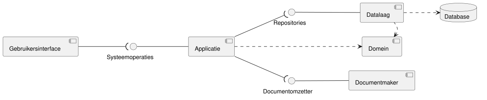

# Architectuur

Met de requirements uit de vorige hoofdstukken begint het ontwerp.
Dit hoofdstuk verdeelt ICDE in lagen en zet elke laag op een server.
De hoofdstukken [Klassendiagram](07-klassendiagram.md#klassendiagram) en
[Sequence diagrams](08-sequencediagrammen.md#sequence-diagrams) werken de applicatie en het domein
uit.
De ontwerpkeuzes A1 en A2 staan in het hoofdstuk
[Ontwerpkeuzes](09-ontwerpkeuzes.md#architectuur).

## Component diagram

Het component diagram toont de lagen en de interfaces ertussen.

| Component | Inhoud | Server |
| --- | --- | --- |
| Gebruikersinterface | Schermen, buiten dit ontwerp | Webserver |
| Applicatie | De handlers, package `applicatie` | Applicatieserver |
| Domein | Domeinklassen, regels, repository-interfaces, package `domein` | Applicatieserver |
| Datalaag | De implementatie van de repositories | Applicatieserver |
| Database | De gegevens | Databaseserver |
| Documentmaker | Maakt van inhoud en opmaak een PDF- of Word-bestand | Documentserver |

- Systeemoperaties zijn de operaties van de handlers.
  Het zijn de systeemoperaties uit de system sequence diagrams.
- Repositories zijn de interfaces OWERepository, OpleidingRepository en
  DocumentsjabloonRepository.
  Ze horen bij het domein, en de datalaag implementeert ze (K2).
  De datalaag hangt dus af van het domein, niet andersom.
- Documentomzetter is een interface van het domein, en de documentmaker biedt haar aan (A2, K5).
  De applicatie roept de documentmaker aan over het netwerk.
