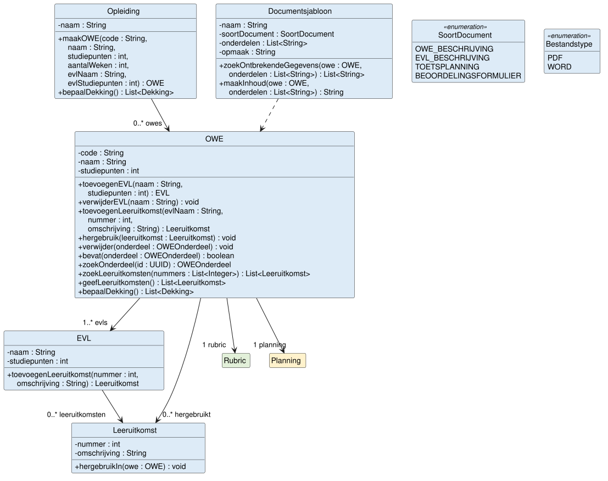
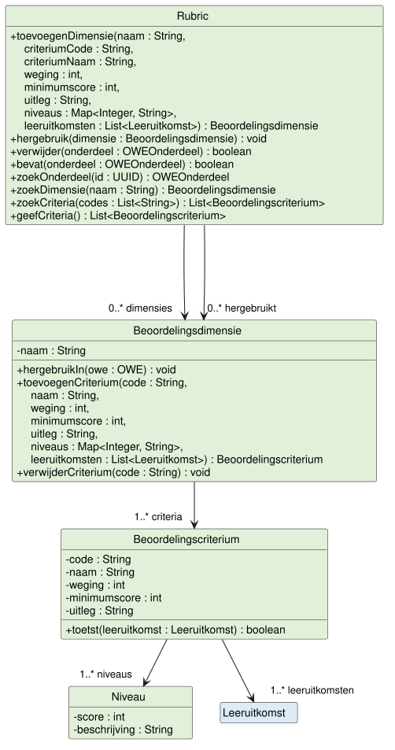
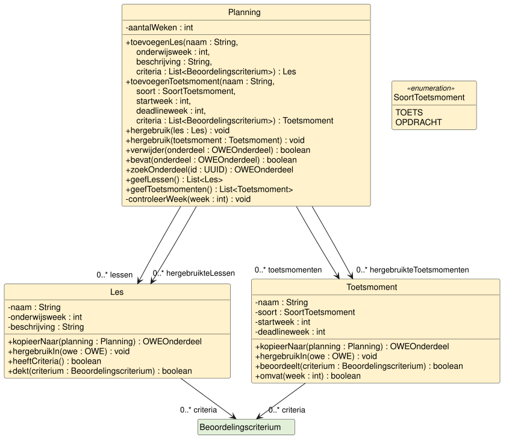
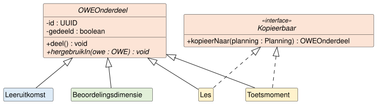
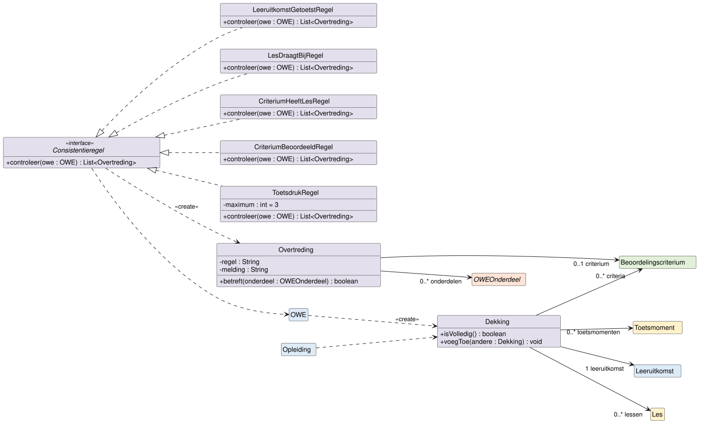
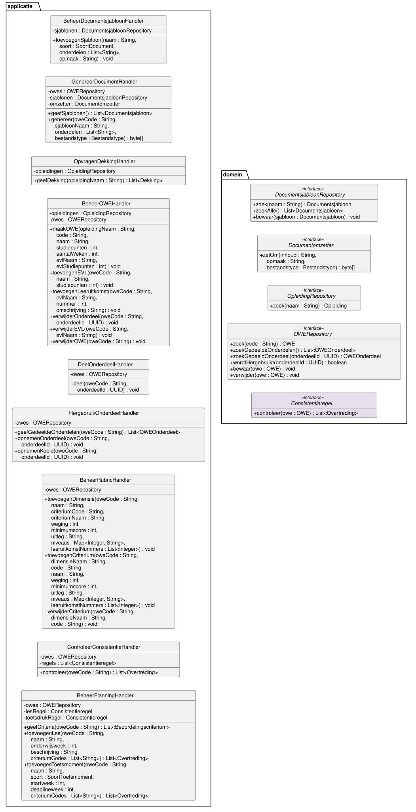

# Klassendiagram

Dit hoofdstuk werkt de applicatie- en domeinlaag uit als design class diagram (DCD).

## Aanpak

Een associatie heeft geen naam.
Multipliciteit en rolnaam staan alleen aan de doelkant (Larman 7.4).
De systeemoperaties komen uit de
[system sequence diagrams](08-sequencediagrammen.md#system-sequence-diagrams).
De GRASP-patterns verdelen de verantwoordelijkheden, en de sequence diagrams controleren het
ontwerp.

## Klassendiagrammen

Het ontwerp staat in zes diagrammen, zodat elk diagram leesbaar blijft.
Elke klasse staat in één diagram volledig, met attributen en operaties.
In een ander diagram staat ze alleen met haar naam.
Elke parameter van een operatie staat op een eigen regel.

De kleur van een klasse toont in welk diagram ze volledig staat.
Een klasse heeft in elk diagram dezelfde kleur.

| Kleur | Diagram waarin de klasse volledig staat |
| --- | --- |
| Blauw | OWE en documentsjabloon |
| Groen | Rubric |
| Geel | Planning |
| Oranje | OWEOnderdeel en hergebruik |
| Paars | Consistentieregels en dekking |
| Grijs | Handlers en repositories |

### OWE en documentsjabloon

OWE heeft de EVL's en leeruitkomsten, en één Rubric en één Planning (K9).

### Rubric

### Planning

### OWEOnderdeel en hergebruik

Leeruitkomst, Beoordelingsdimensie, Les en Toetsmoment zijn een OWEOnderdeel.
Alleen Les en Toetsmoment zijn Kopieerbaar (K6).

### Consistentieregels en dekking

### Handlers en repositories

## Van domeinmodel naar ontwerp

De elf concepten zijn elf klassen met dezelfde naam, zonder streepje: OWEOnderdeel.
Net als het domeinmodel gebruikt het klassendiagram geen compositie.
OWEOnderdeel krijgt een id (UUID), waarmee UC07 en UC09 een onderdeel aanwijzen.
Rubric en Planning zijn ontwerpklassen zonder concept in het domeinmodel (K9).
Het attribuut aantalWeken van OWE staat in Planning, omdat alleen de planning de looptijd gebruikt.

Elke associatie is navigeerbaar in één richting, van eigenaar naar onderdeel en van les of
toetsmoment naar criterium, zonder cyclus (Low Coupling).
Een vraag in de andere richting gaat naar een klasse met overzicht, zoals Planning voor de lessen
bij een criterium en OWERepository.wordtHergebruikt voor BR13.

## Traceerbaarheid

### Per use case

| Use case | Handler | Klassen en operaties |
| --- | --- | --- |
| UC01 | BeheerOWEHandler | Opleiding.maakOWE, OWE.toevoegenEVL, OWE.verwijderEVL |
| UC02 | BeheerOWEHandler | OWE.toevoegenLeeruitkomst, EVL.toevoegenLeeruitkomst |
| UC03 | BeheerRubricHandler | Rubric.toevoegenDimensie, Beoordelingsdimensie.toevoegenCriterium |
| UC04 | BeheerPlanningHandler | Rubric.zoekCriteria, Planning.toevoegenLes, LesDraagtBijRegel |
| UC05 | ControleerConsistentieHandler | Consistentieregel met vijf regels, Overtreding |
| UC06 | GenereerDocumentHandler | Documentsjabloon.maakInhoud, Documentomzetter.zetOm |
| UC07 | HergebruikOnderdeelHandler | OWE.bevat, OWEOnderdeel.hergebruikIn, kopieerNaar |
| UC08 | OpvragenDekkingHandler | Opleiding.bepaalDekking, OWE.bepaalDekking, Dekking.voegToe |
| UC09 | DeelOnderdeelHandler | OWEOnderdeel.deel |
| UC10 | BeheerDocumentsjabloonHandler | Documentsjabloon |
| UC11 | BeheerPlanningHandler | Planning.toevoegenToetsmoment, ToetsdrukRegel |

De namen van de use cases staan in het [overzicht use cases](03-use-cases.md#overzicht-use-cases).

Verwijderen gaat zo:

- Een leeruitkomst, dimensie, les of toetsmoment: BeheerOWEHandler.verwijderOnderdeel en
  OWE.verwijder.
  Eén operatie is genoeg, omdat het allemaal een OWEOnderdeel is.
  OWE geeft de vraag door aan Rubric en Planning (K9).
- Een criterium is geen OWEOnderdeel: BeheerRubricHandler.verwijderCriterium en
  Beoordelingsdimensie.verwijderCriterium.
- Een EVL is geen OWEOnderdeel: BeheerOWEHandler.verwijderEVL en OWE.verwijderEVL.
- Een OWE: BeheerOWEHandler.verwijderOWE en OWERepository.verwijder.

### Per bedrijfsregel

Per regel de klasse die de regel controleert, en het sequence diagram (SD) dat de regel toont.
De regels zonder SD horen bij CRUD use cases, zie de
[aanpak van de sequence diagrams](08-sequencediagrammen.md#aanpak).

| Regel | Klasse en operatie | SD |
| --- | --- | --- |
| BR1 | LeeruitkomstGetoetstRegel, met Beoordelingscriterium.toetst | BR1 |
| BR2 | LesDraagtBijRegel, met Les.heeftCriteria | controleer, toevoegenLes |
| BR3 | CriteriumHeeftLesRegel, met Les.dekt | controleer |
| BR4 | CriteriumBeoordeeldRegel, met Toetsmoment.beoordeelt | controleer |
| BR5 | ToetsdrukRegel, met Toetsmoment.omvat | BR5, toevoegenToetsmoment |
| BR6 | OWEOnderdeel.hergebruikIn bewaart een verwijzing, geen kopie | opnemenOnderdeel |
| BR7 | Alleen de OWE die het onderdeel in de eigen lijsten heeft, wijzigt het | - |
| BR8 | Opleiding.maakOWE met de eerste EVL, OWE.verwijderEVL, OWERepository.zoek | - |
| BR9 | EVL.toevoegenLeeruitkomst, met OWE voor een uniek nummer | - |
| BR10 | Rubric.toevoegenDimensie, Beoordelingsdimensie.toevoegenCriterium, verwijderCriterium | - |
| BR11 | Planning.toevoegenLes, controleerWeek, Rubric.zoekCriteria | toevoegenLes, opnemenKopie |
| BR12 | BeheerDocumentsjabloonHandler, met DocumentsjabloonRepository.zoek | - |
| BR13 | verwijderOnderdeel, verwijderCriterium, verwijderOWE, OWERepository.wordtHergebruikt | - |
| BR14 | Planning.toevoegenToetsmoment, controleerWeek, Rubric.zoekCriteria | toevoegenToetsmoment |

## Wat niet in de diagrammen staat

- Getters en setters, omdat ze weinig informatie toevoegen (Larman 7.6).
- Constructors, omdat de maak-operaties al tonen wie wat maakt (K7).
- Wijzigen en bekijken bij de CRUD use cases, met dezelfde parameters als toevoegen.
- Foutmeldingen: een validatieregel of exceptional flow gooit een OngeldigeInvoerException,
  zoals flow 2A van UC05 en flow 4A van UC04, UC06, UC07 en UC11.
- De gebruikersinterface en de implementatie van de repositories en van Documentomzetter, die bij
  blok 2 horen.
