# Sequence diagrams

Dit hoofdstuk toont hoe de klassen samenwerken, en controleert zo het klassendiagram.
De ontwerpkeuzes S1 tot en met S3 staan in het hoofdstuk
[Ontwerpkeuzes](09-ontwerpkeuzes.md#sequence-diagrams).

## Aanpak

De diagrammen dekken de use cases met logica: UC05 tot en met UC08, en het toevoegen bij UC04 en
UC11.
Een system sequence diagram (SSD) per use case levert de systeemoperaties.
Een sequence diagram (SD) per systeemoperatie toont hoe de handler het werk verdeelt.
Een systeemoperatie die alleen gegevens ophaalt, krijgt geen SD.

De actor roept de handler direct aan, zonder gebruikersinterface.
Een exception is een stippellijn `OngeldigeInvoerException` met de flow uit de use case, zoals
(2A).
De SD's gebruiken getters en constructors (`create`) die het klassendiagram weglaat.

## System sequence diagrams

UC04 en UC11 hebben geen SSD: stap 2 is `geefCriteria`, stap 3 tot en met 6 de toevoegoperatie.

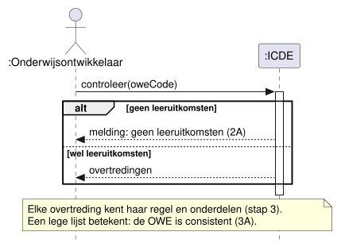

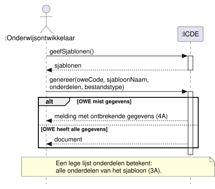

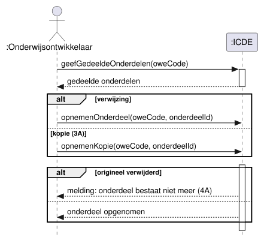

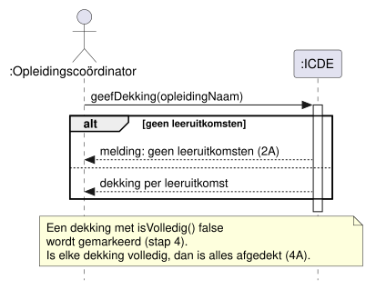

`geefCriteria` geeft `rubric.geefCriteria()`: de eigen en hergebruikte criteria (BR11, BR14).
`geefGedeeldeOnderdelen` laat de onderdelen weg waarvoor `owe.bevat` true geeft.

## Diagrammen per use case

### UC04 Toevoegen les

Rubric zoekt de criteria op, en Planning maakt de les en controleert de week (BR11, 4A).
Daarna controleert LesDraagtBijRegel BR2.
De handler geeft alleen de overtredingen van de nieuwe les terug (6A, S2).

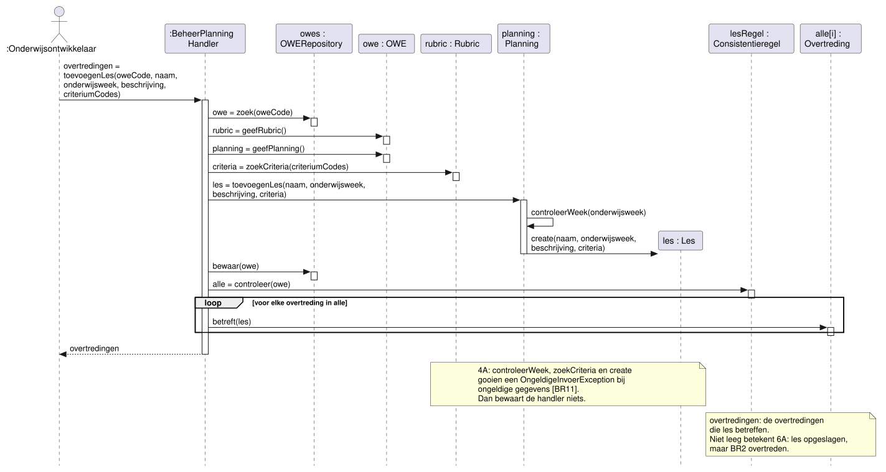

### UC05 Controleren consistentie OWE

De handler kent alleen de interface Consistentieregel.
`controleer(owe)` is een polymorfe message: elke regel werkt haar eigen controle uit.

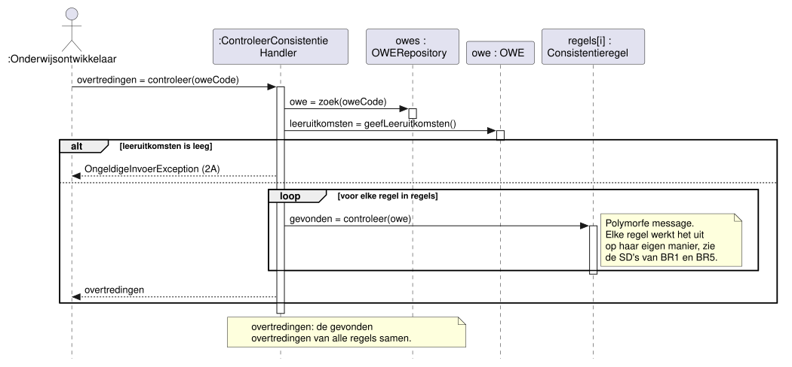

Een polymorfe message krijgt een SD per uitwerking (Larman 8.21).
BR1 en BR5 hebben elk een eigen vorm.

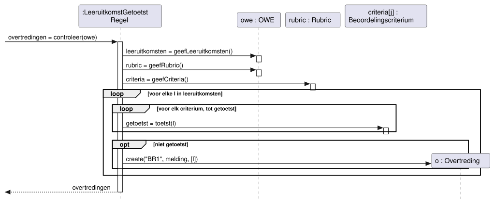

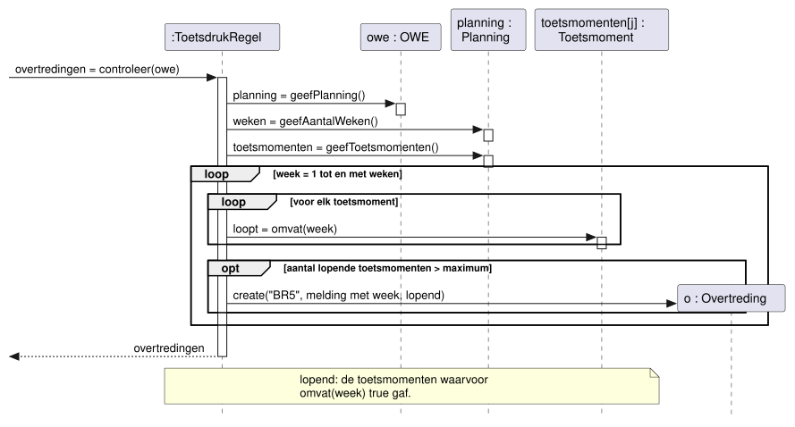

BR2, BR3 en BR4 hebben de vorm van BR1, met een andere lus en vraag:

| Regel | Lus over | Vraag per element |
| --- | --- | --- |
| BR2 LesDraagtBijRegel | `planning.geefLessen()` | `les.heeftCriteria()` |
| BR3 CriteriumHeeftLesRegel | `rubric.geefCriteria()` | `les.dekt(c)`, voor elke les |
| BR4 CriteriumBeoordeeldRegel | `rubric.geefCriteria()` | `t.beoordeelt(c)`, voor elk toetsmoment |

### UC06 Genereren document

Documentsjabloon controleert eerst of de OWE de gegevens heeft (4A) en maakt dan de inhoud.
Documentomzetter maakt van de inhoud en de opmaak het bestand (K5).

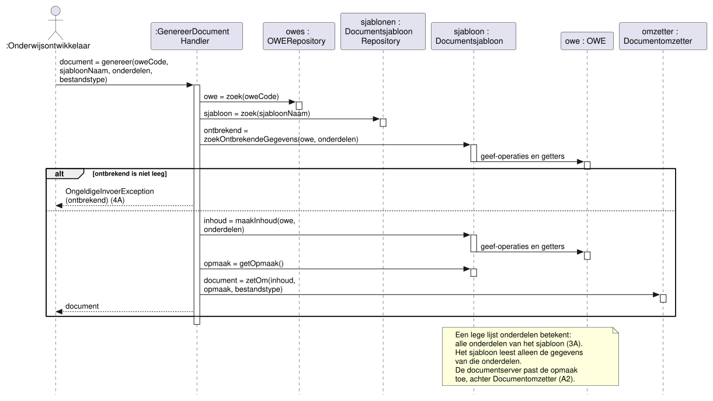

### UC07 Hergebruiken gedeeld onderdeel

OWERepository vindt alleen gedeelde onderdelen.
Is het origineel verwijderd, dan volgt 4A.
Het onderdeel kiest zelf de lijst waarin het komt (`hergebruikIn`), en daar staat een verwijzing,
geen kopie (BR6).

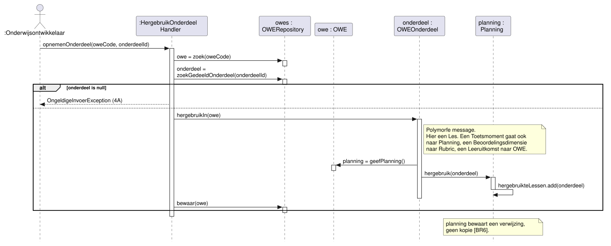

Een kopie (3A) loopt via de toevoegoperatie van Planning (S3).

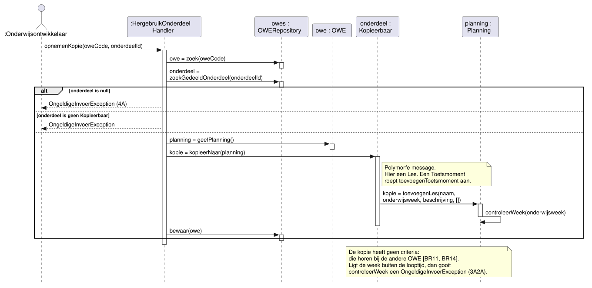

### UC08 Opvragen dekkingsoverzicht

Opleiding vraagt elke OWE om haar dekking.
Een hergebruikte leeruitkomst komt in meer OWE's voor, dus Opleiding voegt die dekkingen samen met
`Dekking.voegToe`.
De gebruikersinterface markeert elke dekking waarvoor `isVolledig()` false geeft.

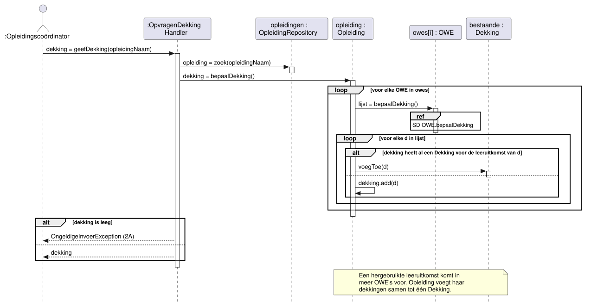

OWE kent via Rubric en Planning alle leeruitkomsten, criteria, toetsmomenten en lessen.
Daarom bepaalt OWE de dekking en maakt de Dekking-objecten (Information Expert, Creator).

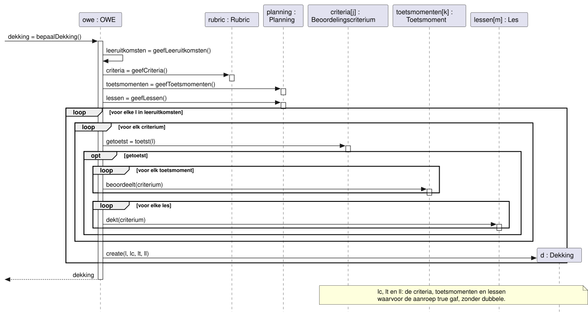

### UC11 Toevoegen toetsmoment

Dit volgt het patroon van UC04, met BR14 en ToetsdrukRegel (BR5).

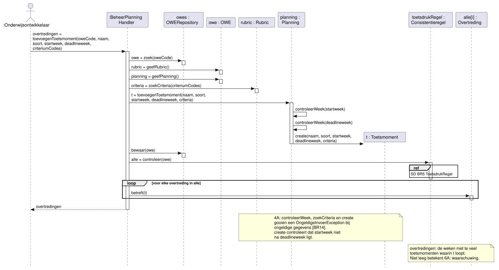
