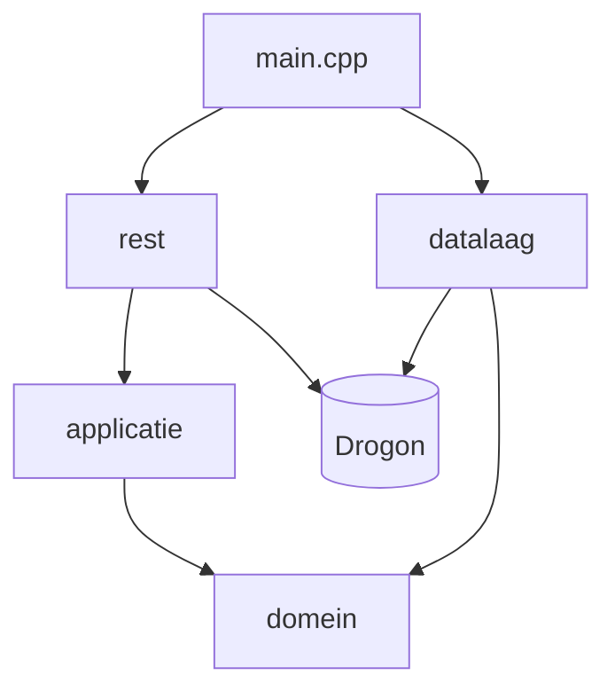

# Layers of the API

The API in `api/` has four layers.
The chapter Architectuur in the design document gives these layers.
A layer can use only the layers below it.

Example: the domein does not know about the database.
Because of this, you can test the domein without a database.
You can also change the database and keep the domein as it is.

The build checks these rules.
If code breaks a rule, the build stops with an error.

## The layers

| Layer | Folder | Contents | Can use |
| --- | --- | --- | --- |
| `domein` | `api/src/domein/` | Domain classes, business rules, repository interfaces | Nothing |
| `applicatie` | `api/src/applicatie/` | Handlers, one for each use case | `domein` |
| `datalaag` | `api/src/datalaag/` | Repositories for PostgreSQL | `domein`, Drogon |
| `rest` | `api/src/rest/` | REST endpoints | `applicatie`, Drogon, JsonCpp |

An arrow in this graph means "uses":



The domein has the repository interfaces.
The datalaag has the classes that implement these interfaces.
Thus the arrow goes from the datalaag to the domein, not from the domein to the datalaag.
This is the Dependency Inversion Principle.

`api/src/main.cpp` is the only file that knows `rest` and `datalaag`.
It starts the server and registers the routes.
It also gives the repositories to the handlers.
Put no business rules in this file.

## How the build checks the rules

`api/CMakeLists.txt` has all the checks.

### Each layer is a library

Each layer is a library in CMake.
`target_link_libraries` gives the layers and packages that a library can use.

### A layer sees only the headers that it can use

Each library shows only its own folder to the compiler.
A library also sees the folders of the libraries that it links.
Example: `applicatie` links `domein`.
`applicatie` therefore sees `src/applicatie` and `src/domein`, but not `src/datalaag`.

If you include a header from `datalaag` in `applicatie`, the compiler does not find it:

```text
src/applicatie/OpleidingHandler.cpp:2:10: fatal error: 'PostgresOpleidingRepository.hpp' file not found
```

### No include with ../

For an include in quotes, the compiler looks first in the folder of the current file.
Thus `#include "../datalaag/PostgresOpleidingRepository.hpp"` finds the header of a different layer.
To stop this, CMake reads all files in `src/` and `tests/`.
If a file has an include with `../`, CMake stops:

```text
CMake Error at CMakeLists.txt:70 (message):
  /src/src/applicatie/OpleidingHandler.cpp: include a header by its name,
  without ../
```

### domein and applicatie link no packages

vcpkg puts the headers of all packages in one folder.
If `domein` links one package, it also sees the Drogon headers in that folder.
Thus CMake stops if `domein` links a package.
CMake also stops if `applicatie` links something other than `domein`:

```text
CMake Error at CMakeLists.txt:60 (message):
  applicatie may link only domein, but links: domein;JsonCpp::JsonCpp
```

Because `domein` links no package, a Drogon header in `domein` gives an error:

```text
src/domein/Opleiding.cpp:2:10: fatal error: 'drogon/drogon.h' file not found
```

## What the build does not check

The build cannot find these two errors.
Look for them when you review code.

- `rest` sees the headers of `domein`, because the handlers return domain objects.
  An endpoint must call a handler.
  It must not call a repository.
- `rest` links Drogon, and Drogon can send SQL to the database.
  An endpoint must not send SQL.
  Only the `datalaag` reads and writes the database.

## Do the test yourself

1. Go to the root folder of the repository.
2. Build the API:

   ```sh
   docker build api
   ```

3. Add `#include <drogon/drogon.h>` to `api/src/domein/Opleiding.cpp`.
4. Build the API again.
   The build stops with the error `'drogon/drogon.h' file not found`.
5. Remove the include.
