# Sequence diagrams ICDE

Dit document toont het dynamische ontwerp van ICDE: hoe de objecten samenwerken om de
kern-use-cases uit te voeren.
Het bouwt voort op de [use case beschrijvingen](use-case-beschrijvingen.md) en het
[klassendiagram](klassendiagram.md).
Bronnen: de lessen System Sequence Diagrams, Thema 4-1 Sequence Diagrams en "Van use case tot
design" (week 2), Sequence diagrams en GRASP Controller (week 4), de richtlijnen bij Mastermind en
Larman hoofdstuk 4 (System Sequence Diagrams) en 8 (UML Interaction Diagrams).

## Aanpak

We volgen de werkwijze uit de cursus (Sequence diagrams, dia 8 en 9) en de richtlijnen bij
Mastermind (dia 20).
Per use case levert een system sequence diagram (SSD) de systeemoperaties.
Per systeemoperatie toont een sequence diagram (SD) hoe de handler uit het klassendiagram het werk
verdeelt (GRASP Controller).
Een systeemoperatie die alleen gegevens ophaalt, krijgt geen SD.

Wat de SD's weglaten of anders tonen:

- De gebruikersinterface staat niet in de SD's, zoals in "Van use case tot design".
  De actor stuurt de systeemoperatie direct naar de handler.
- Een exception staat als stippellijn met de naam `OngeldigeInvoerException` en de flow uit de
  use case, zoals (2A).
- De SD's gebruiken getters die het klassendiagram niet toont, zoals `geefAantalWeken`
  (Larman 7.6).
  Ze maken objecten met `create`, en het klassendiagram toont geen constructors.
- VergrendelVeldHandler staat niet in de SD's.
  De gebruikersinterface vraagt de vergrendeling per invoerveld aan, los van de
  systeemoperaties (keuze 9 in het klassendiagram).

## Keuze van de use cases

We maken SD's voor de use cases die fully dressed zijn uitgewerkt, omdat daar de logica zit:
UC05, UC06, UC08 en UC07, en het toevoegen bij UC04 en UC11.
De andere CRUD use cases volgen het CRUD-sjabloon en hebben geen eigen logica.
Hun systeemoperaties staan in de [traceerbaarheid](klassendiagram.md#traceerbaarheid) van het
klassendiagram.

## System sequence diagrams

Het SSD gebruikt parameters zonder datatype, omdat het bij de analyse hoort (Van use case tot
design, par. 7).
UC04 en UC11 hebben geen SSD: Toevoegen les en Toevoegen toetsmoment hebben elk één
systeemoperatie, zie de tabel hieronder.
In de SSD's is een exception een melding met de flow uit de use case.

UC05 Controleren consistentie OWE:

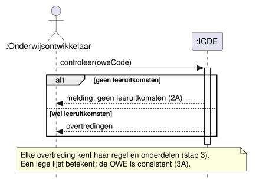

UC06 Genereren document:

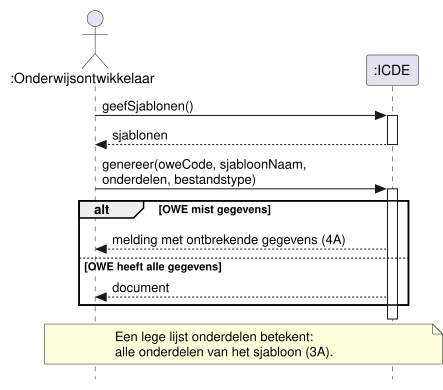

UC07 Hergebruiken gedeeld onderdeel:

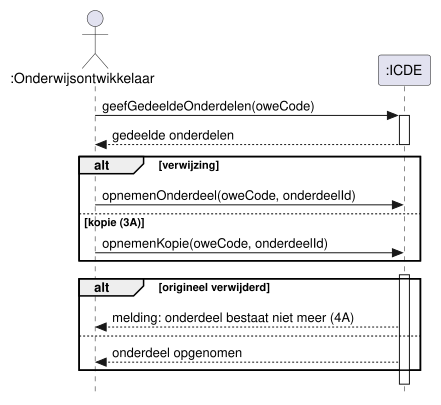

UC08 Opvragen dekkingsoverzicht:

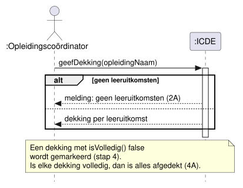

## Systeemoperaties

| Use case | Systeemoperatie | Handler | Sequence diagram |
| --- | --- | --- | --- |
| UC05 | controleer | ControleerConsistentieHandler | SD controleer, SD BR1, SD BR5 |
| UC06 | geefSjablonen | GenereerDocumentHandler | Geen, zie onder |
| UC06 | genereer | GenereerDocumentHandler | SD genereer |
| UC07 | geefGedeeldeOnderdelen | HergebruikOnderdeelHandler | Geen, zie onder |
| UC07 | opnemenOnderdeel | HergebruikOnderdeelHandler | SD opnemenOnderdeel |
| UC07 | opnemenKopie | HergebruikOnderdeelHandler | SD opnemenKopie |
| UC08 | geefDekking | OpvragenDekkingHandler | SD geefDekking, SD OWE.bepaalDekking |
| UC04 | toevoegenLes | BeheerPlanningHandler | SD toevoegenLes |
| UC11 | toevoegenToetsmoment | BeheerPlanningHandler | SD toevoegenToetsmoment |

Twee systeemoperaties halen alleen gegevens op en hebben geen eigen SD.
`geefSjablonen` roept `sjablonen.zoekAlle()` aan.
`geefGedeeldeOnderdelen` roept `owes.zoekGedeeldeOnderdelen()` aan en laat de onderdelen weg
waarvoor `owe.bevat` true geeft.

## Sequence diagrams

### UC05 Controleren consistentie OWE

`controleer` voert stap 1 tot en met 3 uit.
De handler kent alleen de interface Consistentieregel.
`controleer(owe)` op een regel is een polymorfe message: elke regel werkt haar eigen controle uit.

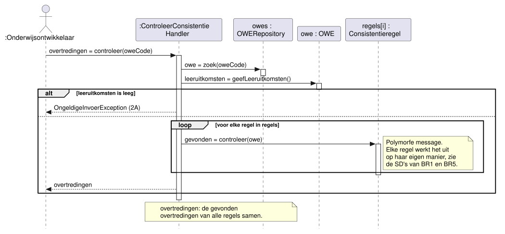

De cursus vraagt een apart SD per concrete uitwerking van een polymorfe message (Sequence
diagrams, dia 30, en Larman figuur 8.21).
We tekenen BR1 en BR5, omdat die twee verschillende vormen hebben.

BR1 LeeruitkomstGetoetstRegel zoekt per leeruitkomst een criterium dat haar toetst:

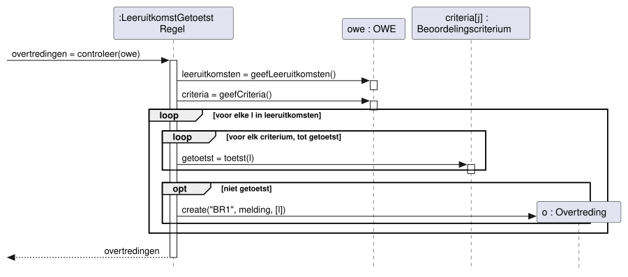

BR2, BR3 en BR4 hebben dezelfde vorm als BR1, met een andere lus en vraag:

| Regel | Lus over | Vraag per element |
| --- | --- | --- |
| BR2 LesDraagtBijRegel | `owe.geefLessen()` | `les.heeftCriteria()` |
| BR3 CriteriumHeeftLesRegel | `owe.geefCriteria()` | `les.dekt(c)`, voor elke les |
| BR4 CriteriumBeoordeeldRegel | `owe.geefCriteria()` | `t.beoordeelt(c)`, voor elk toetsmoment |

BR5 ToetsdrukRegel telt per week de lopende toetsmomenten.
UC11 gebruikt dezelfde regel.

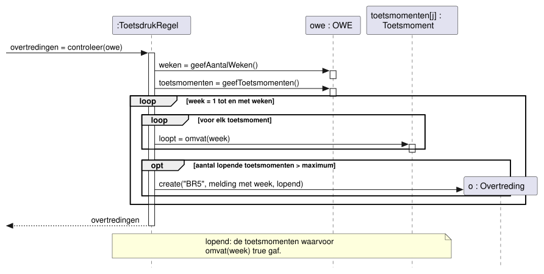

### UC06 Genereren document

`genereer` voert stap 3 tot en met 5 uit.
Documentsjabloon controleert eerst of de OWE de gegevens van de gekozen onderdelen heeft (stap 4).
Daarna maakt het sjabloon het document (stap 5).

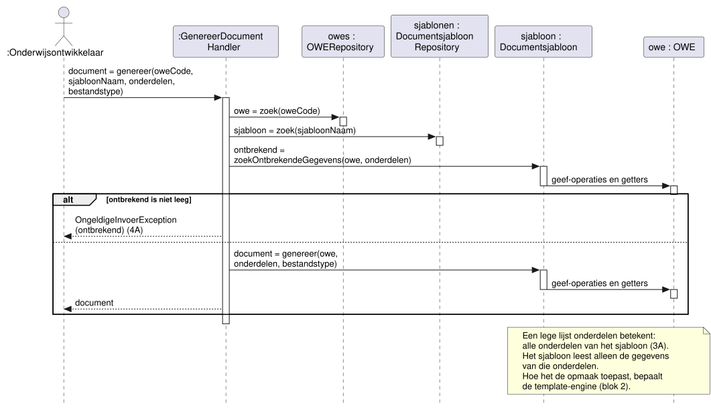

### UC07 Hergebruiken gedeeld onderdeel

`opnemenOnderdeel` voert stap 3 en 4 uit.
OWERepository vindt alleen een gedeeld onderdeel.
Is het origineel verwijderd, dan vindt de repository niets en volgt 4A.
OWE bewaart een verwijzing naar het originele object, zodat de OWE elke wijziging ziet (BR6).

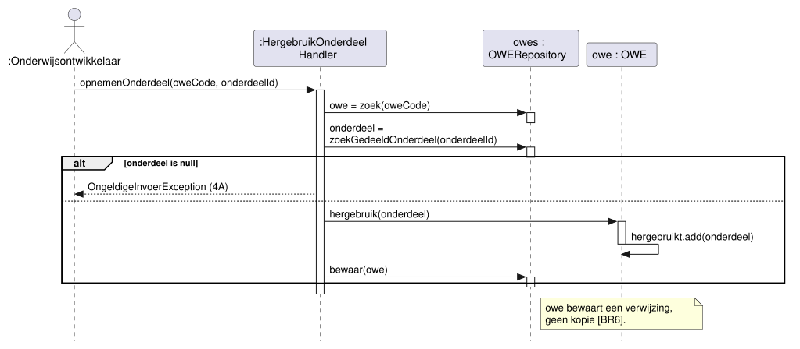

`opnemenKopie` voert flow 3A uit.
`kopieerNaar(owe)` is een polymorfe message: een Les roept `owe.toevoegenLes` aan, een
Toetsmoment `owe.toevoegenToetsmoment`.
Zie keuze 3.

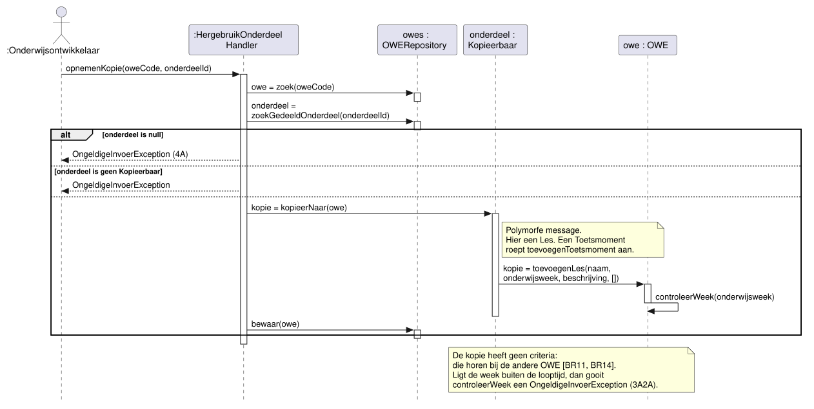

### UC08 Opvragen dekkingsoverzicht

`geefDekking` voert stap 1 tot en met 4 uit.
Bij het tonen markeert de gebruikersinterface elke dekking waarvoor `isVolledig()` false geeft.
Opleiding vraagt elke OWE om haar dekking.

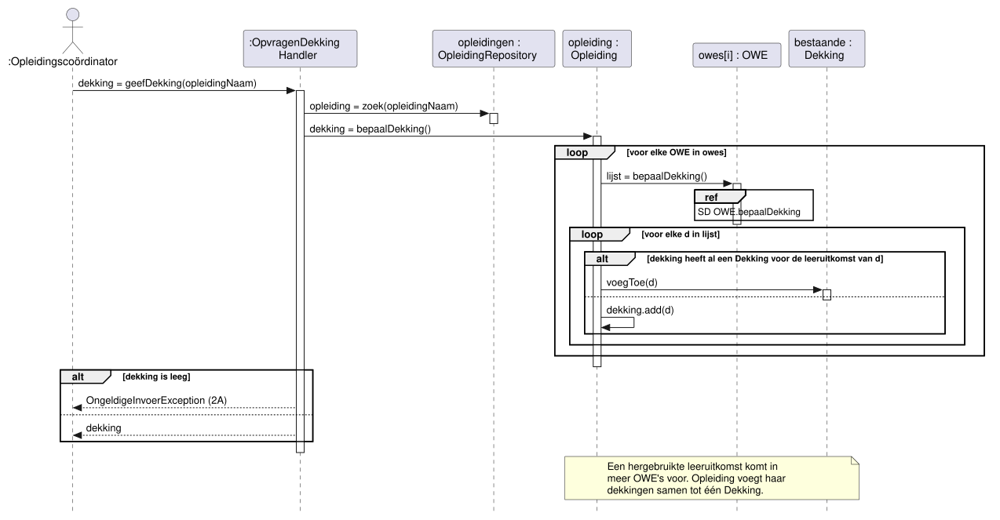

OWE bepaalt de dekking, omdat OWE alle leeruitkomsten, criteria, toetsmomenten en lessen kent
(Information Expert, keuze 4 in het klassendiagram).
OWE maakt de Dekking-objecten (Creator), omdat OWE de gegevens voor de constructor heeft.

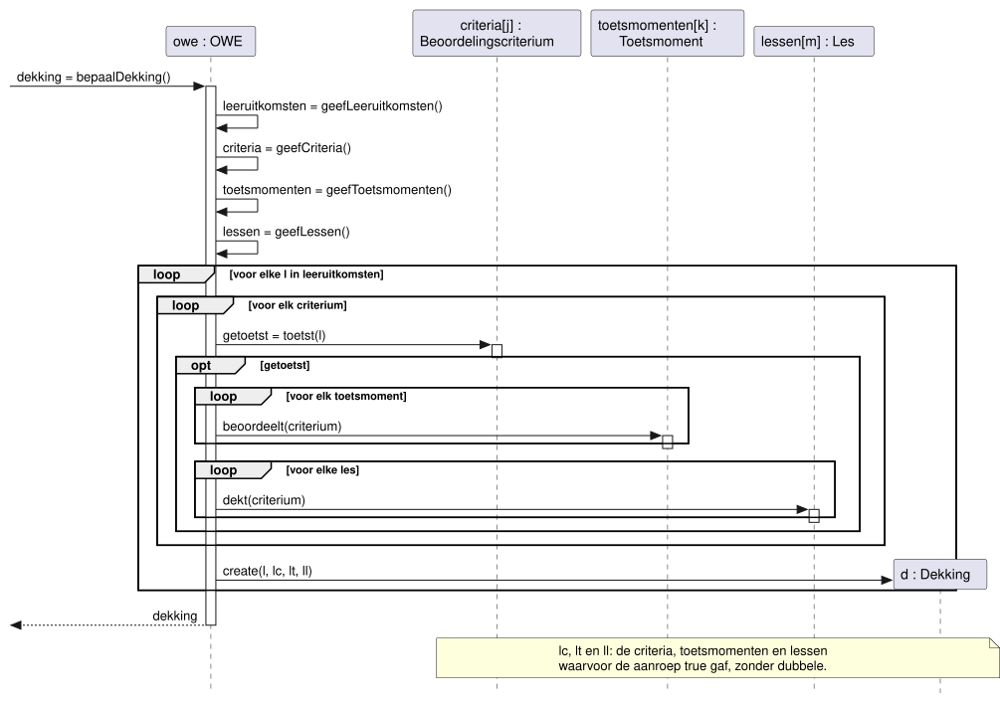

### UC04 Beheren lesplanning

`toevoegenLes` voert stap 3 tot en met 6 van Toevoegen les uit.
OWE maakt de les (Creator) en controleert de week en de criteria (BR11, 4A).
Na het bewaren vraagt de handler LesDraagtBijRegel om BR2.
Van alle overtredingen geeft de handler alleen die van de nieuwe les terug (6A).

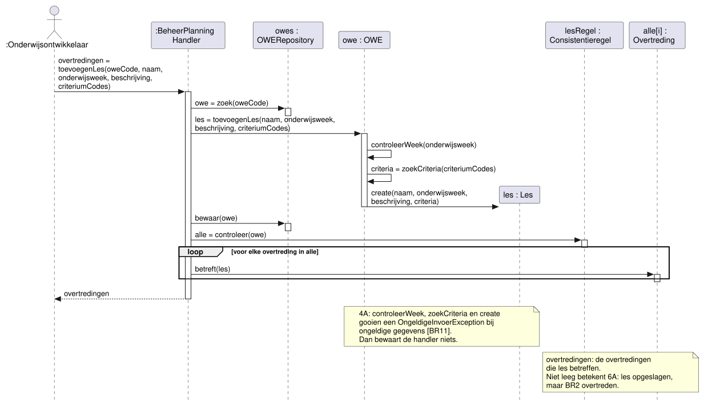

### UC11 Beheren toetsplanning

`toevoegenToetsmoment` voert stap 3 tot en met 6 van Toevoegen toetsmoment uit.
Het volgt hetzelfde patroon als `toevoegenLes`, met BR14 en ToetsdrukRegel (BR5).

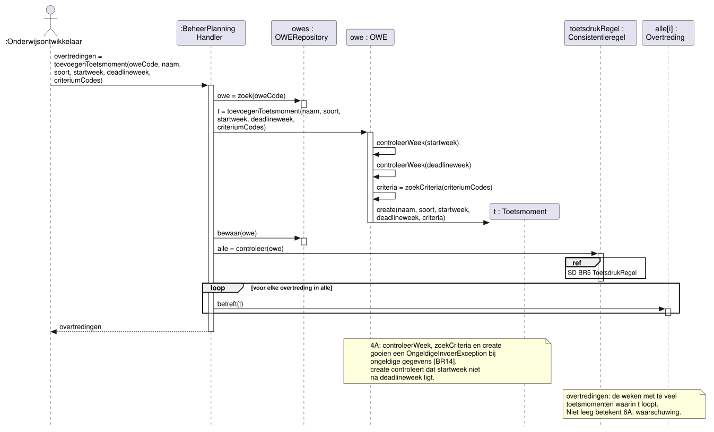

## Keuzes

Elke keuze noemt het probleem, de alternatieven en de onderbouwing.

| Nr | Keuze | Principe |
| --- | --- | --- |
| 1 | [Controle bij de gegevens](#controle-bij-de-gegevens) | Expert |
| 2 | [Overtreding kent haar onderdelen](#overtreding-kent-haar-onderdelen) | Expert |
| 3 | [Kopie via toevoegen](#kopie-via-toevoegen) | Polymorphism |
| 4 | [OWE blijft één klasse](#owe-blijft-één-klasse) | High Cohesion |

Expert is GRASP Information Expert.

### Controle bij de gegevens

Probleem: de use cases hebben exceptional flows, zoals 2A in UC05 en 4A in UC04.
Waar staat de controle?

| Alternatief | Nadeel |
| --- | --- |
| De handler controleert alle invoer voor hij het domein aanroept | De handler kent de regels |

Zo groeit de handler tot een bloated controller (GRASP Controller, dia 15).

Keuze: het object dat de gegevens heeft, controleert ze.

- OWE controleert de week (`controleerWeek`) en de criteria (`zoekCriteria`).
- Toetsmoment controleert dat de startweek niet na de deadlineweek ligt.
- De handler controleert alleen of er iets te doen is, zoals 2A in UC05 en UC08.

### Overtreding kent haar onderdelen

Probleem: UC04 (6A) en UC11 (6A) melden alleen een overtreding van het nieuwe onderdeel.
Een consistentieregel controleert de hele OWE.

| Alternatief | Nadeel |
| --- | --- |
| Een tweede operatie `controleer(owe, onderdeel)` op elke regel | Twee bijna gelijke operaties |
| De handler controleert BR2 zelf met `les.heeftCriteria()` | BR2 op twee plaatsen |

Het tweede alternatief werkt niet voor BR5, want die telt over alle toetsmomenten.

Keuze: Overtreding kent de onderdelen die de regel overtreden en beantwoordt
`betreft(onderdeel)`.

- De handler filtert de overtredingen van de regel.
  Zo blijft elke regel op één plaats.
- BR3 en BR4 gaan over een criterium, en een criterium is geen OWEOnderdeel.
  Daarom kent Overtreding ook `0..1 criterium`.
- UC05 toont met dezelfde gegevens per regel de onderdelen (stap 3).

### Kopie via toevoegen

Probleem: in UC07 (3A) neemt OWE een kopie van een les of toetsmoment op.
De kopie moet in de lijst van haar soort, en OWE controleert de week (BR11, BR14).

| Alternatief | Nadeel |
| --- | --- |
| OWE.kopieer vraagt de kopie en zet haar in de juiste lijst | OWE test de soort van de kopie |
| De handler vraagt de kopie en roept de toevoegoperatie aan | De handler test de soort |

Een test op de soort is een switch op het type, en die vervangt GRASP Polymorphism.

Keuze: `Kopieerbaar.kopieerNaar(owe)`.

- Les roept `owe.toevoegenLes` aan, Toetsmoment `owe.toevoegenToetsmoment`, zonder criteria.
- OWE controleert de week dus zoals bij toevoegen.
- OWE heeft geen operatie `kopieer` nodig.

### OWE blijft één klasse

Probleem: OWE heeft 19 operaties, zie keuze 4 in het klassendiagram.

| Alternatief | Nadeel |
| --- | --- |
| De zoek- en geef-operaties naar een eigen klasse | Die klasse kent alle lijsten van OWE |

Dan geeft OWE zijn structuur prijs.

Keuze: OWE blijft zoals hij is.
De SD's laten zien dat elke operatie van OWE kort is en alleen de eigen lijsten gebruikt.
De cohesie is dus hoog, ook met 19 operaties.
