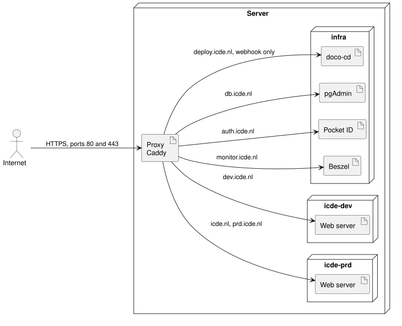
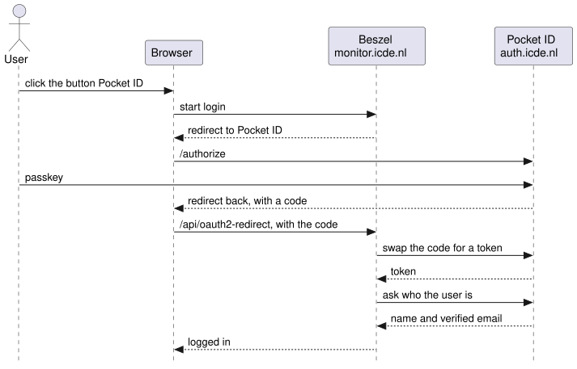

# Server

The server that runs ICDE, and the files that belong to it.
[Deployment](deployment.md) describes how a change reaches it.

## Files

| File | Purpose |
| --- | --- |
| `compose.yaml` | The stack on a laptop |
| `compose.server.yaml` | The stack on the server, once per environment |
| `db/schema.sql` | The tables |
| `.doco-cd.prd.yml` | doco-cd settings for `main`: production and `infra` |
| `.doco-cd.dev.yml` | doco-cd settings for `develop`: development |
| `infra/compose.yaml` | Proxy, doco-cd, Beszel, Pocket ID and pgAdmin |
| `infra/Caddyfile` | Which name the proxy passes to which container |
| `infra/setup.sh` | Connects Beszel and pgAdmin to Pocket ID |
| `infra/pgadmin-servers.json` | The two databases that pgAdmin shows |
| `.github/workflows/deploy.yml` | Builds the images and tells doco-cd |

Three things to know:

- PostgreSQL runs `db/schema.sql` only in an empty database.
  After a change, delete the database: `docker compose down --volumes` on a laptop, the volumes
  `icde-prd_db-data` and `icde-dev_db-data` on the server.
- The database password is in the Compose files.
  That is accepted while the database holds no real data.
- Store data in a named volume, never in a relative bind mount such as `./data`.
  doco-cd runs each commit from a fresh copy of the repository, so that data is lost.

## The server

| | |
| --- | --- |
| Provider | mijn.host, VPS size S: 1 core, 4 GB memory, 20 GB disk |
| Operating system | Debian 13 |
| Clock | UTC |

| Setting | Value | File on the server |
| --- | --- | --- |
| SSH | Keys only, no passwords | `/etc/ssh/sshd_config.d/00-keys-only.conf` |
| fail2ban | One hour block after five failed SSH logins | `/etc/fail2ban/jail.d/icde.conf` |
| Firewall | From the internet only SSH, HTTP and HTTPS | `/etc/nftables.conf` |
| Docker | Engine and Compose from Docker's repository | `/etc/apt/sources.list.d/` |
| Container logs | At most 3 files of 10 MB per container | `/etc/docker/daemon.json` |
| IPv6 | On for containers | `/etc/docker/daemon.json` |
| Updates | Daily, for Debian and Docker | `/etc/apt/apt.conf.d/52unattended-upgrades-icde` |
| Restart | At 04:00 UTC when an update needs it | The same file |
| Secrets | Readable by root only | `/srv/infra/.env` |

A restart or a Docker update takes the sites down for about a minute.

The firewall is the nftables table `inet host-firewall`.
It lets in TCP ports 22, 80 and 443, and UDP port 443 for HTTP/3.
Traffic between containers, and from containers to the server, stays open.
A port that a Compose file publishes stays closed to the internet, unless it is 80 or 443.
Docker and fail2ban keep their own tables.
For that reason, `/etc/nftables.conf` has no `flush ruleset`, and
`/etc/systemd/system/nftables.service.d/icde.conf` makes `systemctl stop nftables` remove only
`host-firewall`.
Check a change with `nft -c -f /etc/nftables.conf` and load it with `systemctl reload nftables`.

The proxy passes each name to one container, as set in `infra/Caddyfile`:

## Secrets

`/srv/infra/.env` holds seven values.
Make each one with `openssl rand -hex 32`.
doco-cd reads the file when it deploys `infra`.

| Name | Purpose |
| --- | --- |
| `WEBHOOK_SECRET` | Signs the message from GitHub to doco-cd |
| `POCKET_ID_ENCRYPTION_KEY` | Encrypts the data of Pocket ID |
| `POCKET_ID_API_KEY` | Lets `setup.sh` call Pocket ID |
| `BESZEL_OIDC_SECRET` | Beszel proves who it is to Pocket ID |
| `BESZEL_ADMIN_PASSWORD` | The admin account of Beszel, `admin@icde.nl` |
| `PGADMIN_OIDC_SECRET` | pgAdmin proves who it is to Pocket ID |
| `PGADMIN_ADMIN_PASSWORD` | The admin account of pgAdmin, which cannot log in |

Keep a copy of `POCKET_ID_ENCRYPTION_KEY`: without it the data of Pocket ID is unreadable.

## Monitoring, database and login

| Address | Program | Purpose |
| --- | --- | --- |
| <https://monitor.icde.nl> | Beszel | Processor, memory, disk and network, per container |
| <https://db.icde.nl> | pgAdmin | View and edit the databases of production and development |
| <https://auth.icde.nl> | Pocket ID | Accounts, with login by passkey |

Beszel and pgAdmin use the login of Pocket ID.
The ICDE sites do not.

A login to Beszel goes through Pocket ID and back:

The container `setup` runs `infra/setup.sh` at every start of `infra`.
The script does what neither program can read from a file:

- registers Beszel and pgAdmin as clients in Pocket ID
- marks every email address in Pocket ID as verified, because Beszel refuses an unverified one
- sets Pocket ID as the login of Beszel
- gives the Beszel agent the key of Beszel
- adds the server as a system in Beszel

It skips what is already in place.
`docker logs infra-setup-1` shows what it did.

Accounts are made by hand, in Pocket ID:

- An admin adds the user and ticks `Email verified`.
- A user without a passkey gets a one-time login code from the admin.
- The user logs in to Beszel or pgAdmin with the button `Pocket ID`.
  Each program makes the account at the first login.

## pgAdmin

pgAdmin shows two servers, `icde-prd` and `icde-dev`, in the group `ICDE`.
The password of both databases is `icde`.
pgAdmin asks for it at the first connection and can save it per user.

pgAdmin reaches the databases over the network `database`.
`infra` makes that network, and the database of each environment joins it as
`icde-prd-db` or `icde-dev-db`.
Start `infra` before the environments, or their start fails on the missing network.

pgAdmin reads `infra/pgadmin-servers.json` only at its first start.
After a change to that file, delete the volume `infra_pgadmin-data`.
Users then lose their saved passwords and settings.

## Set up a new server

Only the first start is by hand.
After that, doco-cd keeps the application and `infra` up to date.

1. Install Debian 13 and Docker Engine with the Compose plugin.
2. Apply the settings from the table under [The server](#the-server).
3. Point the DNS records from [Deployment](deployment.md#dns) to the server.
4. Copy the directory `infra/` to `/srv/infra/` on the server.
5. Make `/srv/infra/.env` with the seven values, readable by root only.
6. Run `docker compose up -d` in `/srv/infra/`.
7. Open <https://auth.icde.nl/setup> at once and make the admin account of Pocket ID.
   The first visitor of that address becomes admin.
8. Run `docker compose up -d` again, so `setup.sh` verifies the email address.
9. Store the value of `WEBHOOK_SECRET` as a secret in the GitHub environments `production` and
   `development`.

For another domain, replace `icde.nl` in `infra/Caddyfile`, `infra/compose.yaml`,
`infra/setup.sh` and `.github/workflows/deploy.yml`.
