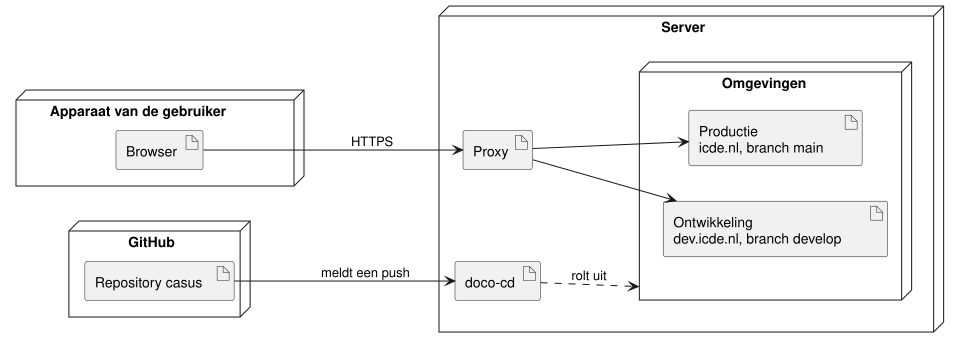
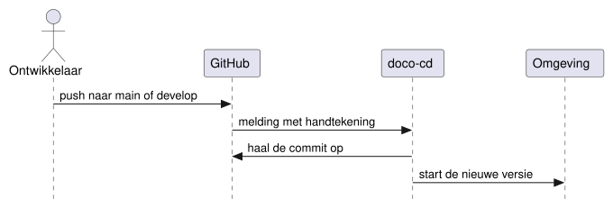

# Uitrol

Dit document beschrijft waar het prototype van ICDE draait, en hoe een wijziging daar komt.
De commando's staan in `infra/README.md`.

## Omgevingen

| Omgeving | Adres | Branch |
| --- | --- | --- |
| Productie | `https://icde.nl` | `main` |
| Ontwikkeling | `https://dev.icde.nl` | `develop` |

Een push naar een van die branches staat binnen enkele seconden op de server.

Op de server draaien drie Compose-projecten.

| Project | Inhoud | Wie start het |
| --- | --- | --- |
| `infra` | De proxy (Caddy) en doco-cd | Een beheerder, met de hand |
| `icde` | Productie: webserver, applicatieserver en database | doco-cd |
| `icde-dev` | Ontwikkeling: dezelfde drie, met een eigen database | doco-cd |

Alleen de proxy is bereikbaar vanaf het internet.
De proxy regelt de certificaten en stuurt elke naam door:
`icde.nl` en `dev.icde.nl` naar de webserver van die omgeving, `deploy.icde.nl` naar doco-cd.

## Van push tot nieuwe versie

1. Een ontwikkelaar merget een pull request naar `main` of `develop`.
2. De workflow `Deploy` bouwt de images en draait daarbij de unittests.
   De images komen in de registry van GitHub, met de branch als tag.
3. De workflow stuurt een melding met een handtekening naar doco-cd.
4. doco-cd controleert de handtekening en haalt de commit op.
5. doco-cd haalt de images op en start de stack van de omgeving.
   Docker vervangt alleen de gewijzigde containers.

De workflow start alleen als de commit de stack wijzigt:
`compose.server.yaml`, `.doco-cd.yml`, `.doco-cd.dev.yml`, `api/`, `web/`, `db/` of `infra/`.
Gaat een melding verloren, dan vindt doco-cd de commit zelf: het kijkt elk uur op GitHub.
Het project `infra` rolt niet vanzelf uit, een beheerder doet dat met de hand.

## Laptop en server

Elke plek heeft één eigen Compose-bestand met dezelfde drie containers.

| | Laptop | Server |
| --- | --- | --- |
| Bestand | `compose.yaml` | `compose.server.yaml` |
| Adres | `http://localhost:8080` | `https://icde.nl` of `https://dev.icde.nl` |
| Images | Bouwt ze zelf | Haalt ze op uit de registry |
| Wie start het | De ontwikkelaar | doco-cd |

## Veiligheid

doco-cd start alles wat in de Compose-bestanden staat.
Wie een gevolgde branch mag wijzigen, bestuurt dus de server.

- doco-cd volgt alleen `main` en `develop`.
  Een wijziging komt daar alleen via een pull request.
- Alleen de workflow `Deploy` op die twee branches kan het geheim `WEBHOOK_SECRET` gebruiken.
  De webhook van GitHub zelf is niet gebruikt, omdat die elke branch meldt.
- Het geheim staat in GitHub en op de server, niet in de repository.
- Beide omgevingen delen één doco-cd.
  Wie `develop` mag wijzigen, kan dus ook productie raken.
  Voor een prototype is dat aanvaard.

## DNS

Het domein staat bij mijn.host.
De records `icde.nl` en `*.icde.nl` (A en AAAA) wijzen naar het vaste adres van de server.
