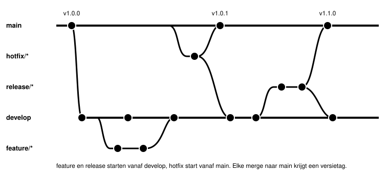

# Working agreements

How the team handles commits, branches, issues, pull requests and updates.

## Commit messages

Use [Conventional Commits](https://www.conventionalcommits.org/): `type(scope): subject`.
Example: `docs(domeinmodel): add Toetsmoment`.
Allowed types: `feat`, `fix`, `docs`, `refactor`, `test`, `perf`, `build`, `ci`, `chore`,
`style`, `revert`.
Link an issue in the footer with `Fixes #123` or `Refs #123`.

## Branches

We use [git flow](https://nvie.com/posts/a-successful-git-branching-model/).

| Branch | Starts from | Merges into | Purpose |
| --- | --- | --- | --- |
| `main` | | | Released versions only, each with a version tag |
| `develop` | | | Work for the next release |
| `feature/<topic>` | `develop` | `develop` | One change, through a pull request |
| `release/<version>` | `develop` | `main` and `develop` | Last fixes before a release |
| `hotfix/<topic>` | `main` | `main` and `develop` | An urgent fix |

## Issues and pull requests

- Every issue gets a label: `documentation`, `enhancement` or `question`.
- A pull request names its issue with `Fixes #123`.
- Titles of issues and pull requests are in Dutch, commit messages in English.

## Dependency updates

Dependabot opens a pull request to `develop` each week when new versions exist.
Its settings are in `.github/dependabot.yml`.

| Kind | Where |
| --- | --- |
| GitHub Actions | `.github/workflows/` |
| Base images | The Dockerfiles in `api/`, `documentserver/` and `web/` |
| Container images | The Compose files in the root and in `infra/` |
| npm packages | `web/` |
| vcpkg packages | `builtin-baseline` in the two `vcpkg.json` files |

Review these pull requests like any other: the build must pass.
For a vcpkg pull request, set the vcpkg tag in the two Dockerfiles to the same version by hand.
